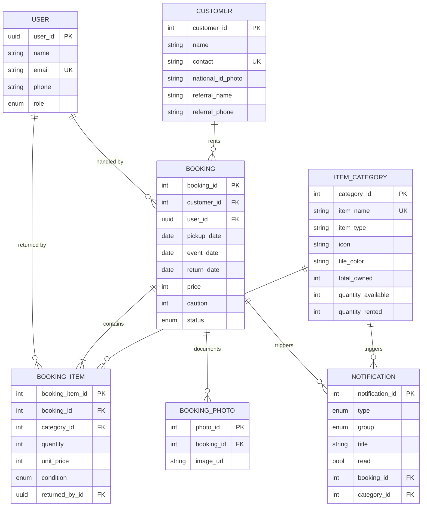
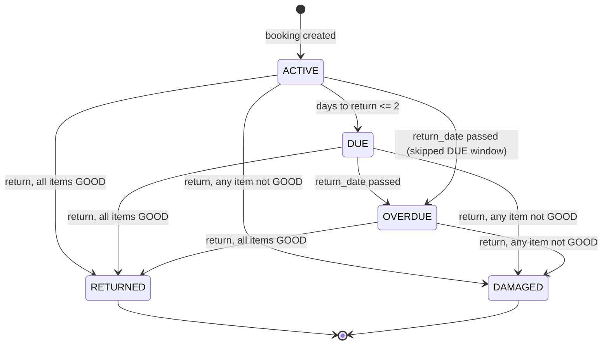

# DRMS System Design: ERD & Permissions - Plan

## Goal Capsule

- **Objective:** Establish the canonical target-state data model (ERD) and permission model (RBAC) for DRMS — a rental/booking management system — and define the implementation units that align the codebase to that design.
- **Authority hierarchy:** This plan's Requirements win over current code where they conflict, except where current code already encodes an intentional product decision (e.g. the Admin/Staff role split documented in `main.py`'s route grouping) — those decisions are carried forward as requirements, not overridden.
- **Stop conditions:** If executing a unit would require a new role, a new actor (e.g. a customer-facing account), or a product-scope decision not evidenced anywhere in the current app, stop and route back to `ce-brainstorm` rather than inventing scope.
- **Execution profile:** `code` — small, low-risk alignment work per unit, not a rewrite. No implementation happens during this planning pass.
- **Tail ownership:** `ce-work` or a human implementer owns execution of the Implementation Units below. This plan does not cover deployment or rollout.

---

## Product Contract

### Summary

DRMS is a rental/booking management system: staff check items out of category-tracked inventory to customers as bookings, track condition on return, and get notified about due/overdue/low-stock events. This plan formalizes the canonical entity model and the two-role permission system as a single source of truth, and closes the small gaps between that target design and the current schema.

### Problem Frame

The codebase has grown by direct implementation (models, routes, migrations) with no single document describing the intended data model or access-control rules. That makes two things hard to verify: whether the schema is internally consistent (a recent migration already added columns — `icon`, `tile_color` — that the ORM model hasn't caught up to), and whether every route's authorization matches the product's own stated intent (the Admin/Staff split described in `main.py`'s `openapi_tags`, but never written down as a rule). This plan produces that reference and the small set of units needed to make the code match it.

### Requirements

**Data model**
- R1. The system's canonical entities are `User`, `Customer`, `ItemCategory`, `Booking`, `BookingItem`, `BookingPhoto`, and `Notification`, related booking-centrically: a `Booking` owns its `BookingItem`s and `BookingPhoto`s, and each `BookingItem` draws from an `ItemCategory`'s stock.
- R2. Every domain entity carries `created_at` / `updated_at` / `deleted_at` / `is_deleted` for auditability; no domain entity performs a hard delete.
- R3. Primary keys use UUID for `User` (security-sensitive identity) and auto-increment integers for every other domain entity, matching the existing convention (see `migrations/versions/e10c9d899ae8_fix_users_user_id_column_to_be_uuid_not_.py`).

**Access control**
- R4. Exactly two roles exist — Admin and Staff — and Admin's permissions are a strict superset of Staff's.
- R5. Staff can fully operate day-to-day rental work: customers, category/inventory management, bookings (including photo upload and returns), and notifications.
- R6. Only Admin can manage staff accounts (create, list, get, update, deactivate) and view the analytics summary.
- R7. Every authenticated endpoint requires a valid bearer session tied to a non-deactivated user. Exactly one Admin account exists, seeded at startup (`service/auth.py: seed_default_admin`).

**Booking lifecycle**
- R8. A booking's status moves automatically among `ACTIVE` → `DUE` → `OVERDUE` based on days remaining to `return_date`, and only moves to `RETURNED` or `DAMAGED` through an explicit return action.
- R9. Returning a booking records per-item condition; any condition other than `GOOD` marks the whole booking `DAMAGED` and writes the reported quantity off category stock, while an all-`GOOD` return releases the rented quantity back to available stock.
- R10. Category stock fields (`total_owned` / `quantity_available` / `quantity_rented`) stay consistent with open booking items and never go negative.

**Notifications and derived data**
- R11. The system raises a notification for due-soon returns, overdue returns, low stock (≤3 available), and any non-`GOOD` return, each linked to its originating booking or category where applicable.
- R12. Customer reputation and the analytics summary are computed on read from booking history — neither is a persisted entity.

### Scope Boundaries

**In scope:** the ERD, the permission model and its enforcement audit, booking-lifecycle and notification-rule formalization, the reputation/analytics read-model contract, and the small alignment fixes each of those exposes.

**Out of scope:** new roles or a customer-facing account tier, UI/frontend work, deployment/infrastructure, payment processing changes.

#### Deferred to Follow-Up Work
- A stricter access or audit policy for national ID photo access (PII sensitivity) — see Open Questions.
- A scheduled/background job for booking-status refresh, as an alternative to the current lazy on-read refresh.
- A persisted audit-log entity.

### Open Questions

- OQ1 (deferred). Should national ID photo access ever be restricted beyond "any authenticated Staff/Admin," given its PII sensitivity? No current requirement forces this; worth a dedicated compliance pass later.
- OQ2 (deferred). Should destructive-looking Staff actions (delete customer/category) ever require Admin confirmation, or does soft-delete's recoverability make that unnecessary indefinitely? This plan assumes the latter (KTD5) but flags it as revisitable.

Neither question blocks implementation-readiness — both are non-blocking and deferred.

### Sources & Research

- `main.py:16-36` — the app's own `openapi_tags` description is the primary evidence for the Admin/Staff permission split (R4-R6).
- `utils/security.py` — `get_current_user` / `require_admin` are the two enforcement primitives every route already composes from.
- `service/booking.py: refresh_all_statuses`, `process_return` — source of the booking status lifecycle (R8-R9) and notification triggers (R11).
- `service/category.py: adjust_rented`, `write_off`, `is_low_stock` — source of the stock-consistency rules (R10) and the low-stock threshold (3 units).
- `service/reputation.py`, `service/analytics.py` — confirm reputation and analytics are computed, not persisted (R12).
- `migrations/versions/897d284b1c03_add_category_display_fields_booking_.py` — adds `items_category.icon` and `items_category.tile_color`; `models/itemCategory.py` was not updated to match, which is the drift U1 closes.
- `migrations/versions/e10c9d899ae8_fix_users_user_id_column_to_be_uuid_not_.py` — establishes UUID-for-`User`, integer-for-everything-else as the settled key convention (R3).

---

## Planning Contract

### Key Technical Decisions

- KTD1. **Keep the existing flat two-role RBAC** (Admin/Staff) rather than introducing a granular per-action permission table. The domain has exactly two operational postures today, and the app's own route grouping in `main.py` already documents the split; a granular table would be speculative complexity for a ~20-endpoint surface.
- KTD2. **Treat `ItemCategory.icon` and `.tile_color` as canonical fields**, matching the already-applied migration `897d284b1c03`, even though `models/itemCategory.py` hasn't been updated yet — the ORM model is the artifact lagging the intended schema, not the reverse.
- KTD3. **Reputation and analytics stay computed read-models**, not new tables — matches `service/reputation.py` and `service/analytics.py` exactly and avoids duplicated, staleness-prone state.
- KTD4. **Booking status stays lazily recomputed on read** (`refresh_all_statuses`) rather than moving to a scheduled job — acceptable while staff view bookings frequently through the app; revisit if unattended/API-only access becomes the primary usage pattern.
- KTD5. **Soft-delete is the only "destructive" operation available to Staff** (customer/category delete); no additional Admin gate is added, since `is_deleted` keeps the data recoverable. See OQ2 for the revisit trigger.

### High-Level Technical Design

#### Entity-Relationship Diagram

Every entity below also carries `created_at` / `updated_at` / `deleted_at` / `is_deleted` (R2); omitted from the diagram for readability.

#### Permission Model

Per KTD1, the target design is the flat matrix already implied by `main.py`'s route tags:

| Resource · Action | Staff | Admin |
|---|---|---|
| Auth · Login | ✅ (public) | ✅ (public) |
| Auth · View own profile | ✅ | ✅ |
| Staff Accounts · Create / List / Get / Update / Deactivate | ❌ | ✅ |
| Customers · Create / Read / List / Update / Delete / Upload ID photo / View reputation / View bookings | ✅ | ✅ |
| Categories · Create / Read / List / Update / Delete / Upload image | ✅ | ✅ |
| Bookings · Create / Read / List / Upload photos / Process return | ✅ | ✅ |
| Notifications · List / Mark read | ✅ | ✅ |
| Analytics · View summary | ❌ | ✅ |

#### Booking Status Lifecycle

### Assumptions

- Postgres is the canonical target database (`database/database.py` default `DATABASE_URL`); `models/user.py` and others use `postgresql.UUID` / `postgresql.Enum`-style dialect columns, so test fixtures should run against Postgres rather than SQLite.
- `pytest` is not yet a project dependency (absent from `requirements.txt`; `tests/` is empty) — adding it is a prerequisite folded into U1, not a separate unit.

---

## Implementation Units

### U1. Canonical Data Model Alignment

- **Goal:** Close the gap between the applied migration and the ORM model, and confirm no other model/migration drift exists.
- **Requirements:** R1, R2, R3
- **Dependencies:** none
- **Files:** `models/itemCategory.py`, `requirements.txt` (add `pytest`), `tests/test_models.py`
- **Approach:**
  1. Add `icon` (`String(10)`) and `tile_color` (`String(30)`) columns to `ItemCategory`, matching `migrations/versions/897d284b1c03_add_category_display_fields_booking_.py`.
  2. Diff each of the other six models against their migration history to confirm no further undocumented drift.
  3. Add `pytest` to `requirements.txt` as the test runner this plan's units rely on (`httpx` is already a dependency).
- **Patterns to follow:** existing `Column(...)` declarations in `models/itemCategory.py` for type/nullability style.
- **Execution note:** This is a bug fix — the current model is missing fields the service layer already reads (`service/booking.py`'s `_grouped_items`, `service/analytics.py`'s `top_categories`). Add the regression test first, confirm it fails against the current model, then add the columns.
- **Test scenarios:**
  - Instantiating `ItemCategory` with `icon="🎪"` and `tile_color="#FDE68A"` persists and round-trips both fields.
  - `service.booking.to_booking_dict`'s item summary (via `ItemSummary`) exposes `category.icon` without raising `AttributeError`.
  - `service.analytics.get_summary`'s `top_categories` includes `icon` per category without error.
  - A full model-to-migration column diff across all seven models finds no further drift.
- **Verification:** The app imports cleanly; booking list/detail and analytics-summary responses include `icon` for every category without error.

### U2. RBAC Permission Model Enforcement Audit

- **Goal:** Pin the Permission Model matrix in an automated test so future route additions can't silently drift from it.
- **Requirements:** R4, R5, R6, R7
- **Dependencies:** U1 (Bookings/Analytics success-path scenarios exercise `category.icon`, which U1 fixes)
- **Files:** `tests/test_permissions.py`
- **Approach:**
  1. Parametrize a test client over every route × the Permission Model table above.
  2. No production code change is expected — current enforcement (`utils/security.py`'s `get_current_user` / `require_admin`) already matches the matrix (see Sources & Research); this unit exists to prevent silent drift.
- **Patterns to follow:** `utils/security.py`'s existing `get_current_user` / `require_admin` dependencies.
- **Test scenarios:**
  - A Staff bearer token succeeds on every Customers / Categories / Bookings / Notifications endpoint.
  - A Staff bearer token gets `403` on every `/auth/users*` endpoint and on `GET /analytics/summary`.
  - An Admin bearer token succeeds on every endpoint, including Staff Accounts and Analytics.
  - A request with no token, or an expired/invalid token, gets `401` on every authenticated endpoint.
  - A deactivated (`is_deleted`) user's still-valid token is rejected with `401`.
- **Verification:** The full role × endpoint matrix is exercised by one automated test suite and passes.

### U3. Booking Lifecycle & Notification Trigger Rules

- **Goal:** Formalize the Booking Status Lifecycle diagram as canonical behavior and cover its transitions and notification side effects.
- **Requirements:** R8, R9, R10, R11
- **Dependencies:** U1 (booking fixtures touch category fields U1 fixes)
- **Files:** `tests/test_booking_lifecycle.py`
- **Approach:**
  1. No behavior change expected — `service/booking.py`'s `refresh_all_statuses` and `process_return` already implement the diagram; this unit adds coverage.
- **Patterns to follow:** existing status/notification logic in `service/booking.py` and `service/notification.py`.
- **Test scenarios:**
  - A booking created today with `return_date` 5 days out stays `ACTIVE`.
  - A booking with `return_date` 2 days out transitions to `DUE` and raises exactly one `UPCOMING_RETURNS` notification.
  - A booking whose `return_date` has passed transitions to `OVERDUE` and raises exactly one `OVERDUE` notification.
  - Returning a booking with all items `GOOD` sets status `RETURNED` and releases each item's quantity back to `category.quantity_available`.
  - Returning a booking with any item `DAMAGED` or `MISSING` sets status `DAMAGED`, writes that quantity off `category.total_owned` / `quantity_rented`, and raises one `INVENTORY` notification.
  - Returning an already-`RETURNED` or already-`DAMAGED` booking raises `BookingError`.
  - Creating a booking that requests more units than `category.quantity_available` raises `BookingError` and persists no booking.
  - Creating a booking that drops `category.quantity_available` to ≤3 raises a `LOW_STOCK` notification.
- **Verification:** All transition and trigger scenarios pass; category stock fields never go negative across the suite.

### U4. Reputation & Analytics Read-Model Contracts

- **Goal:** Document and cover the reputation and analytics-summary contracts as computed read-models (KTD3).
- **Requirements:** R12
- **Dependencies:** U1
- **Files:** `tests/test_reputation_analytics.py`
- **Approach:**
  1. Confirm `service/reputation.py` and `service/analytics.py` remain purely computed — no new persisted columns or tables.
- **Patterns to follow:** existing computation logic in `service/reputation.py` and `service/analytics.py`.
- **Test scenarios:**
  - A customer with no closed bookings returns the "New customer" reputation class.
  - A customer whose most recent closed booking is `RETURNED` returns the "Good history" class with the correct rental count.
  - A customer whose most recent closed booking is `DAMAGED` returns the flagged class, surfacing `condition_notes` from the flagged item when present.
  - The analytics summary's `revenue` reflects only the current month's bookings; `active_rentals` counts only `ACTIVE`/`DUE`/`OVERDUE` bookings; `most_rented_category` matches the highest booking-item count.
- **Test expectation:** the above scenarios are the sole coverage — no schema changes are expected in this unit beyond what U1 already made.
- **Verification:** Reputation and analytics scenarios pass against a seeded set of bookings spanning all five statuses.

---

## Verification Contract

| Command | Applies to | Notes |
|---|---|---|
| `pip install pytest` (once) | U1 | Prerequisite — `pytest` is not yet in `requirements.txt` (`httpx` already is) |
| `pytest tests/ -v` | U1-U4 | Primary gate; all four new test files must pass |
| `python -c "import main"` | U1 | Confirms no import-time `AttributeError` from the model/migration drift fix |
| Manual: `uvicorn main:app --reload`, then exercise `/docs`, logging in as both a Staff and the seeded Admin account | U2 | Cross-checks the automated permission-matrix test against the live Admin/Staff/Auth route grouping |

## Definition of Done

**Global**
- The ERD, Permission Model, and Booking Status Lifecycle in this plan match the deployed schema and route guards exactly — no drift.
- `models/itemCategory.py` matches migration `897d284b1c03` (`icon`, `tile_color` present).
- `pytest tests/ -v` passes for all four new test files.
- No route's authorization dependency differs from the Permission Model table without an explicit, reviewed update to this plan.
- No abandoned exploration code (e.g. a discarded granular-permission-table attempt) remains in the diff.

**Per-unit:** each unit's Verification field above.

---

## Risks & Dependencies

- **Risk:** the model/migration drift U1 fixes is a live latent bug today — any endpoint returning `category.icon` (booking list/detail, analytics summary) throws `AttributeError` against the current `models/itemCategory.py`. Land U1 first.
- **Dependency:** `pytest` is not yet a project dependency; every unit's test scenarios assume it is added first (folded into U1).
- **Dependency:** models use Postgres-specific dialect columns (`postgresql.UUID`, `postgresql.Enum`); test fixtures need a Postgres test database rather than SQLite to run reliably.
