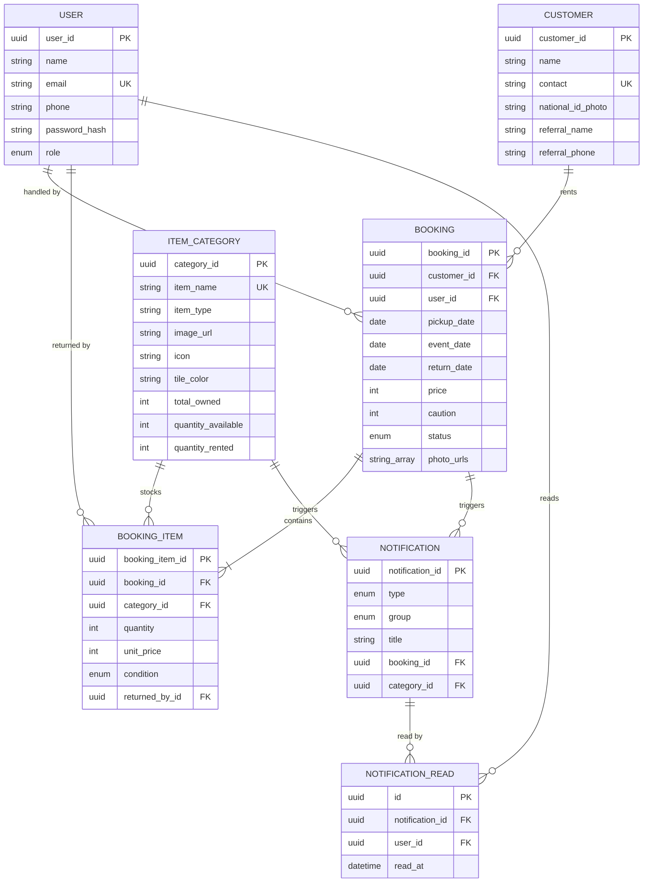
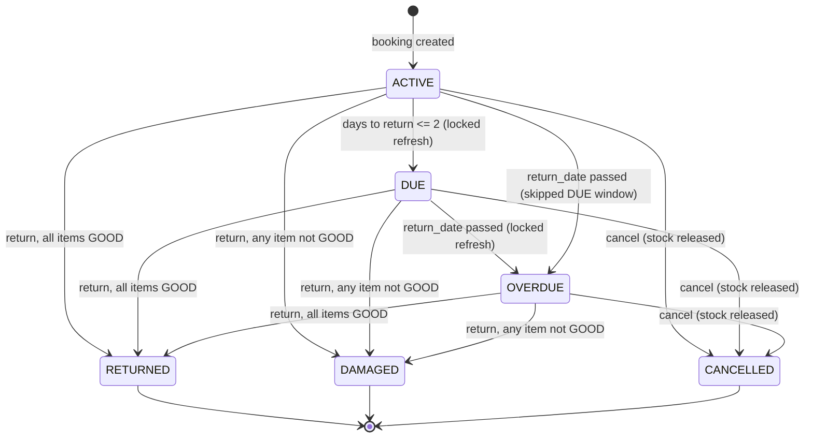

# DRMS Fresh System Design: ERD, Permissions & Phased Rollout - Plan

## Goal Capsule

- **Objective:** Establish a fresh, from-scratch target-state ERD and Admin/Staff permission model for DRMS — a rental/booking management system — and deliver the phased implementation work that brings the existing codebase to that target state.
- **Authority hierarchy:** This plan's ERD, permission matrix, and lifecycle rules are the target state; current code is background context only, not a preservation constraint. Where current behavior conflicts with this plan, this plan wins.
- **Stop conditions:** If executing a unit would require a third role or actor beyond Admin/Staff, UI/frontend work, or a change away from FastAPI/SQLAlchemy/Postgres, stop — those are explicitly out of scope.
- **Execution profile:** `code` — a redesign-and-correct pass delivered as reviewable, phased increments to the existing codebase, not a rewrite.
- **Tail ownership:** `ce-work` or a human implementer owns execution of the Implementation Units below, phase by phase. This plan does not cover deployment or rollout.

---

## Product Contract

### Summary

DRMS is a rental/booking management system: staff check items out of category-tracked inventory to customers as bookings, track condition on return, and get notified about due/overdue/low-stock events. This plan re-derives the canonical entity model and a fully resource+operation-grained Admin/Staff permission system from scratch, corrects several lifecycle and stock-consistency gaps found during research, and phases the resulting work into four delivery phases against the existing FastAPI/SQLAlchemy/Postgres codebase.

### Problem Frame

The current codebase implements two roles (Admin, Staff) but enforces almost nothing between them: `main.py`'s route grouping claims a Staff/Admin split that the actual authorization dependencies don't back up — every Customers/Categories/Bookings/Notifications route accepts any authenticated user, Admin or Staff alike, with `require_admin` gating only staff-account management and analytics. Research also surfaced concrete correctness gaps this redesign needs to close: `ItemCategory`'s model is missing columns (`icon`, `tile_color`) that a migration already added and that live code already reads off ORM instances; `CategoryUpdate` lets any authenticated Staff overwrite `quantity_available`/`quantity_rented` directly, bypassing the stock-adjustment invariant; category and customer deletes require no more authorization than a read; national ID photos are served from a fully unauthenticated static mount; the booking lifecycle has no cancellation state, so a booking created in error has to be processed as a normal return to release its stock, polluting reputation and analytics; returns apply one condition to every item in a booking even though `BookingItem` already has per-item condition columns; and both booking-status refresh and stock allocation have unlocked read-then-write races under concurrent staff use. This plan's ERD and permission matrix are designed to close all of these, not just document the status quo.

### Requirements

**Data model & ERD**
- R1. The system's canonical entities are `User`, `Customer`, `ItemCategory`, `Booking`, `BookingItem`, `Notification`, and `NotificationRead`, related booking-centrically: a `Booking` owns its `BookingItem`s, each `BookingItem` draws from an `ItemCategory`'s stock, and each `Notification` carries independent per-user read state via `NotificationRead`. Booking photos are not a separate entity — `Booking.photo_urls` holds any number of them directly.
- R2. Every domain entity carries `created_at`/`updated_at`/`deleted_at`/`is_deleted` for auditability; no domain entity performs a hard delete.
- R3. Primary keys use UUID for every domain entity, `User` included — a uniform convention rather than a User-only special case, so no entity's id is sequentially enumerable.
- R4. `ItemCategory` declares `icon` and `tile_color` as canonical model fields; `item_name`/`item_type`/`icon`/`tile_color`/`description` are Staff+Admin editable; `total_owned` changes only through an Admin-only restock action; `quantity_available` and `quantity_rented` are never client-settable under any role — they change only through `adjust_rented`/`write_off`/the restock action.

**Access control**
- R5. Exactly two roles exist — Admin and Staff — Admin's permissions are a strict superset of Staff's, and no third actor type is introduced.
- R6. Every authenticated endpoint requires a valid bearer session tied to a non-deactivated user.
- R7. Permission enforcement is resource+operation-grained, not resource-only: Staff may create/read/update non-destructive, non-stock-authoritative data (customers, categories, bookings, notifications); Admin-only operations are staff-account management, the analytics summary, category/customer delete, the category restock action, and national-ID-photo access.
- R8. Uploaded national ID photos are unreachable without authentication, and only to an Admin — both the API field and the underlying file. Booking photos and category images remain on the existing public serving path.
- R9. Deleting an `ItemCategory` is rejected while it has `quantity_rented > 0` (in-flight rentals), regardless of role.

**Booking lifecycle**
- R10. A booking's status moves automatically among `ACTIVE` → `DUE` (≤2 days to `return_date`) → `OVERDUE` (`return_date` passed); it moves to `RETURNED`, `DAMAGED`, or `CANCELLED` only through an explicit action.
- R11. `CANCELLED` is a new terminal status for bookings created in error: cancelling releases every allocated category's stock and excludes the booking from reputation/analytics closed-booking aggregates.
- R12. Returning a booking records condition per `BookingItem`; the booking's status is `DAMAGED` if any item's condition is not `GOOD`, else `RETURNED`. Only the categories behind non-`GOOD` items are written off; only the categories behind `GOOD` items release stock.
- R13. Category stock fields (`total_owned`/`quantity_available`/`quantity_rented`) stay consistent with open booking items, never go negative, and are protected against concurrent overbooking via row-level locking and a DB-level check at allocation time.
- R14. Booking-status transitions (`ACTIVE`→`DUE`→`OVERDUE`) are computed under row-level locking so concurrent reads cannot generate duplicate notifications for the same transition.

**Notifications and derived data**
- R15. The system raises a notification for due-soon returns, overdue returns, low stock (≤3 available), and any non-`GOOD` return, linked to its originating booking or category where applicable.
- R16. Notification read-state is tracked per user, not globally — each user has an independent read/unread state per notification.
- R17. Customer reputation and the analytics summary remain computed read-models, never persisted, and both exclude `CANCELLED` bookings from closed-booking aggregates.

### Acceptance Examples

- AE1. **Mixed-condition return.** Given a booking with 3 chairs and 1 tent checked out, when the tent is returned `DAMAGED` and the chairs `GOOD`, then the booking's status is `DAMAGED`, only the tent's category is written off, and the chairs' category releases stock normally. Covers R12.
- AE2. **Cancellation before return.** Given an `ACTIVE` booking created against the wrong customer, when it is cancelled, then its allocated stock is released, its status is `CANCELLED`, and it never appears in that customer's reputation history or in the analytics closed-booking aggregates. Covers R11, R17.
- AE3. **Concurrent overbooking attempt.** Given a category with `quantity_available = 1`, when two booking-creation requests for that category commit at nearly the same instant, then exactly one succeeds and the other fails with a `BookingError`; `quantity_available` never goes negative. Covers R13.
- AE4. **Staff attempts a destructive action.** Given a Staff bearer token, when it calls `DELETE /categories/{id}` or `DELETE /customers/{id}` or the restock action, then the request is rejected with `403`, regardless of any other permission that role holds. Covers R7, R9.

### Scope Boundaries

**In scope:** the ERD, the resource+operation permission matrix, booking-lifecycle correctness (cancellation, per-item returns, concurrency safety), notification integrity (locking, per-user read state), the national-ID-photo access boundary, reputation/analytics reconciliation, and the phased implementation units delivering all of it within the existing FastAPI/SQLAlchemy/Postgres codebase.

**Out of scope:** new roles or actors beyond Admin/Staff, UI/frontend work, deployment/infrastructure changes, payment processing, and any change away from the current tech stack.

#### Deferred to Follow-Up Work
- Calendar-aware, date-range booking availability — `quantity_available` stays a real-time snapshot; a future-dated booking against currently-checked-out stock is still rejected even if it wouldn't overlap the eventual return. Accepted as an intentional simplification for this plan.
- A persisted audit-log entity.
- Compliance-grade PII handling beyond Admin-only access (encryption at rest, retention policy), if ever required.

### Open Questions

- OQ1 (deferred). Should booking cancellation (U12) be Admin-only rather than Staff+Admin, given it undoes a completed booking-creation action? This plan assumes Staff+Admin, consistent with Staff being able to create bookings in the first place — revisit if cancellation abuse becomes a real concern.
- OQ2 (deferred). Should booking photos and category images also move behind authenticated serving, or is the public static mount acceptable for non-PII uploads? This plan assumes only national ID photos need to move (R8); revisit if other uploaded content turns out to carry sensitivity.

Neither question blocks implementation-readiness — both are non-blocking and deferred.

### Sources & Research

- `utils/security.py` — `get_current_user`/`require_admin`, the two existing enforcement primitives this plan extends rather than replaces.
- `service/booking.py: create_booking, process_return, refresh_all_statuses` — source of the lifecycle behavior this plan corrects (R10-R14).
- `service/category.py: adjust_rented, write_off, update_category` — source of the stock-consistency rules and the `CategoryUpdate` bug this plan closes (R4, R13).
- `schemas/category.py: CategoryUpdate` — confirmed to accept `quantity_available`/`quantity_rented`/`created_at` directly today.
- `main.py: app.mount("/uploads", ...)` — the unauthenticated static-file bypass R8 closes.
- `migrations/versions/897d284b1c03_add_category_display_fields_booking_.py` — adds `items_category.icon`/`tile_color`; `models/itemCategory.py` was never updated to match.
- `migrations/versions/e10c9d899ae8_fix_users_user_id_column_to_be_uuid_not_.py` — originally established UUID-for-`User`, integer-for-everything-else; superseded by KTD3b, which extends UUID to every entity.
- `migrations/versions/ca13461ca7df_convert_business_entity_pks_to_uuid_.py` — delivers KTD3b/KTD3c: converts every remaining Integer PK/FK to UUID with relationship-preserving joins (not the empty-table shortcut `e10c9d899ae8` used), and folds `booking_photos` into `bookings.photo_urls`.
- `docs/plans/2026-08-11-001-docs-system-design-erd-permissions-plan.md` — a prior, narrower code-alignment audit that assumed today's binary enforcement was correct as-is; this plan supersedes that approach with a fresh design that corrects the gaps the audit didn't address. Left in place, not modified.

---

## Planning Contract

### Key Technical Decisions

- KTD1. **Keep exactly two roles, Admin and Staff, with no new actor types.** (session-settled: user-directed — chosen over adding a role such as a Customer self-service tier: the app's whole current surface is staff-operated, and a new actor type is new product scope, not a redesign of what exists.)
- KTD2. **Keep the current tech stack** (FastAPI + SQLAlchemy + Postgres) as the implementation target. (session-settled: user-approved — chosen over reconsidering the stack: nothing in this plan's requirements needs a different stack, and swapping it would turn a redesign into a rewrite.)
- KTD3. **Treat `ItemCategory.icon`/`.tile_color` as canonical fields**, matching the already-applied migration `897d284b1c03` — the ORM model is the artifact lagging the intended schema, not the reverse.
- KTD3b. **Convert every remaining Integer PK/FK to UUID** (`Customer`, `ItemCategory`, `Booking`, `BookingItem`, `Notification`), superseding this plan's original R3/KTD3 (session-settled: user-directed — chosen over keeping the User-only UUID split: uniform PKs across every entity, not just the auth-sensitive one). Delivered via a single migration (`ca13461ca7df`) that generates a UUID per row and propagates it to every referencing FK through a join on the old integer id before the integer columns are dropped, rather than the empty-table shortcut `e10c9d899ae8` used for `users.user_id`.
- KTD3c. **Fold `BookingPhoto` into `Booking.photo_urls`** (a Postgres `ARRAY(String)` column), superseding this plan's original R1 (session-settled: user-directed — chosen over keeping booking photos as their own table: a booking still accepts any number of photos via `POST /bookings/{id}/photos`, which appends to this array; per-photo id/timestamp/soft-delete are given up in exchange for one fewer entity).
- KTD4. **Remove `quantity_available`/`quantity_rented` from every client-writable schema**; only `total_owned` remains directly editable, gated to a dedicated Admin-only restock action that recomputes `quantity_available` from the existing special-cased logic. `quantity_available`/`quantity_rented` change only through `adjust_rented`/`write_off`/the restock action.
- KTD5. **Redesign permission enforcement as resource+operation-grained**, not resource-only. (session-settled: user-approved — chosen over a resource-only split: closes both the stock-field overwrite bug and the delete-without-Admin-check gap that a coarser split wouldn't touch.)
- KTD6. **Category delete requires `quantity_rented == 0`** in addition to the Admin role — an in-flight-rental guard the current `delete_category` doesn't have.
- KTD7. **Restrict national ID photo access to Admin-only, field and file,** and move its serving behind an authenticated route. (session-settled: user-approved — chosen over Staff-permitted-but-gated and over leaving file serving unchanged: closes both the unauthenticated static-mount bypass and the any-Staff PII visibility gap in one move.)
- KTD8. **Add `CANCELLED` as a new terminal `BookingStatus`** with its own stock-release path, excluded from reputation/analytics closed-booking aggregates. (session-settled: user-approved — chosen over keeping only `RETURNED`/`DAMAGED` as terminal states: return-as-`GOOD` was the only way to release stock from an erroneous booking, and it was polluting reputation/analytics with bookings that never actually happened.)
- KTD9. **Rework `process_return` to record condition per `BookingItem`** instead of uniformly across the whole booking, deriving `Booking.status` from the aggregate and writing off/releasing stock only for the categories actually behind non-`GOOD`/`GOOD` items respectively — matching columns `BookingItem` already has but the current service layer ignores.
- KTD10. **Add a DB check** (`quantity_available >= 0 AND quantity_rented >= 0 AND total_owned = quantity_available + quantity_rented`) **plus row-level locking** on the categories touched during booking creation, closing the concurrent-overbooking race.
- KTD11. **Add row-level locking to the existing lazy on-read status-refresh model** rather than moving to a scheduled job. (session-settled: user-approved — chosen over a scheduled background job and over leaving the race unaddressed: the smallest change that closes the duplicate-notification race without adding a scheduler dependency.)
- KTD12. **Track notification read-state per user via a new `NotificationRead` join entity** instead of `Notification.read` as a single shared boolean — a two-role system where both roles act on the same alerts needs independent read state per viewer.
- KTD13. **Verification is manual/behavioral, not an automated test suite.** (session-settled: user-directed — chosen over adding `pytest` and per-unit test scenarios: this plan is for building the system, not for testing it; no test infrastructure or test files are introduced by any unit. Each unit's Verification field describes the behavior to confirm by hand — importing the app, applying migrations, exercising `/docs` — instead of a test command.)

### High-Level Technical Design

#### Entity-Relationship Diagram

Every entity below also carries `created_at`/`updated_at`/`deleted_at`/`is_deleted` (R2); omitted from the diagram for readability. `Notification.read` is removed in favor of `NotificationRead` (KTD12). Every PK/FK is UUID (R3/KTD3b); booking photos are not a separate entity (R1/KTD3c) — `BOOKING.photo_urls` holds them directly.

#### Permission Matrix

Resource+operation grained (KTD5). "Any" means both Staff and Admin; "Admin" means Admin only.

| Resource · Operation | Staff | Admin |
|---|---|---|
| Auth · Login | Public | Public |
| Auth · View own profile | Any | Any |
| Auth · Staff account CRUD/deactivate | ❌ | ✅ |
| Customers · Create/Read/List/Update (non-PII fields) | Any | Any |
| Customers · Delete | ❌ | ✅ |
| Customers · Upload national ID photo | Any | Any |
| Customers · View national ID photo (field + file) | ❌ | ✅ |
| Customers · View reputation, view bookings | Any | Any |
| Categories · Create/Read/List | Any | Any |
| Categories · Update (name/type/image/icon/tile_color/description) | Any | Any |
| Categories · Restock (`total_owned`) | ❌ | ✅ |
| Categories · Delete (blocked if `quantity_rented > 0`) | ❌ | ✅ |
| Categories · Upload image | Any | Any |
| Bookings · Create/Read/List | Any | Any |
| Bookings · Upload photos | Any | Any |
| Bookings · Process return, cancel | Any | Any |
| Notifications · List, mark read (per-user) | Any | Any |
| Analytics · View summary | ❌ | ✅ |

#### Booking Status Lifecycle

### Assumptions

- Postgres is the canonical target database (`database/database.py` default `DATABASE_URL`); models use `postgresql.UUID`/`postgresql.Enum`-style dialect columns and the new CHECK constraint (KTD10) is Postgres syntax, so test fixtures run against Postgres rather than SQLite.
- The existing thin-route → plain-function-service → SQLAlchemy-model layering is preserved as the implementation pattern for every new unit below — this plan does not introduce service classes or a different architectural style.
- Authentication uses JWT bearer tokens plus bcrypt password hashing (built in Phase 4), consistent with keeping the current stack (KTD2) — not a session-cookie or OAuth2 password-grant scheme.
- Per KTD13, this plan introduces no test infrastructure or test files; `requirements.txt` and `tests/` are unchanged by every unit below.

---

## Implementation Units

Phased the way a backend gets built for the first time, start to finish: get the project and database running, model the data, define the contracts on top of it, build identity and access control, build each domain resource, build the booking engine that ties them together, build what's derived from it, then wire the whole thing into one running service. No testing infrastructure is part of this build (KTD13); verification per unit is manual/behavioral.

| U-ID | Title | Files touched | Depends on |
|---|---|---|---|
| U1 | Project Foundation & Configuration | `database/database.py`, `alembic.ini`, `migrations/env.py`, `utils/security.py` | — |
| U2 | Core Domain Entities & Relationships (ERD) | `models/itemCategory.py`, `models/booking.py`, `migrations/versions/` | U1 |
| U3 | Notification & Per-User Read-State Entities | `models/notification.py`, `models/notification_read.py`, `models/__init__.py`, `migrations/versions/` | U1 |
| U4 | Customer & Category Schemas | `schemas/category.py`, `schemas/customer.py` | U2 |
| U5 | Booking & Notification Schemas | `schemas/booking.py`, `schemas/notification.py` | U2, U3 |
| U6 | Authentication System | `utils/security.py`, `service/auth.py`, `schemas/auth.py`, `routes/auth.py` | U1, U2 |
| U7 | Resource+Operation Permission Matrix Enforcement | `utils/security.py`, `routes/category.py`, `routes/customer.py` | U4, U6 |
| U8 | Authenticated File Serving & PII Access Boundary | `main.py`, `utils/file_storage.py`, `routes/customer.py` | U4, U6, U7 |
| U9 | Customer Management | `routes/customer.py`, `service/customer.py` | U4, U7, U8 |
| U10 | Inventory & Stock Service | `routes/category.py`, `service/category.py` | U2, U4, U7 |
| U11 | Booking Creation & Status Lifecycle | `routes/booking.py`, `service/booking.py` | U5, U9, U10 |
| U12 | Booking Return & Cancellation | `service/booking.py`, `routes/booking.py` | U5, U10, U11 |
| U13 | Notifications System | `service/notification.py`, `routes/notification.py` | U3, U5, U11, U12 |
| U14 | Customer Reputation & Booking History | `service/reputation.py`, `routes/customer.py` | U9, U12 |
| U15 | Business Analytics Summary | `service/analytics.py`, `routes/analytics.py` | U12, U13 |
| U16 | Final Assembly & Integration | `main.py` | U1-U15 |

### Phase 1 — Project Foundation & Configuration

#### U1. Project Foundation & Configuration

- **Goal:** Stand up the runtime foundation every later phase depends on: database connectivity, migration tooling, and the security configuration the Authentication phase will build on.
- **Requirements:** none directly; the platform every requirement below is built on.
- **Dependencies:** none
- **Files:** `database/database.py`, `alembic.ini`, `migrations/env.py`, `utils/security.py`
- **Approach:**
  1. Configure the database connection (Postgres, per KTD2) via `DATABASE_URL`, with the SQLAlchemy engine, session factory, and declarative `Base` that every model in Phase 2 registers against.
  2. Wire Alembic's `env.py` to `Base.metadata` so migrations autogenerate correctly against whatever models exist at the time.
  3. Source `SECRET_KEY`, `ALGORITHM`, and `ACCESS_TOKEN_EXPIRE_MINUTES` from the environment for the JWT scheme Phase 4 builds — no committed default secret.
- **Patterns to follow:** standard SQLAlchemy 2.0 sync engine/session setup; `python-dotenv` for local environment loading.
- **Verification:** the app process starts and connects to the configured Postgres database; `alembic revision --autogenerate` produces a correct diff against an empty schema; running without `SECRET_KEY` set refuses to boot rather than falling back to a guessable default.

---

### Phase 2 — Database Design: ERD & Data Model

#### U2. Core Domain Entities & Relationships (ERD)

- **Goal:** Establish the canonical data model — `User`, `Customer`, `ItemCategory`, `Booking`, `BookingItem` — matching this plan's ERD, including the `CANCELLED` booking status and the stock-consistency invariant as a database-level guarantee.
- **Requirements:** R1, R2, R3, R4, R10, R11, R13
- **Dependencies:** U1
- **Files:** `models/itemCategory.py`, `models/booking.py`, `migrations/versions/` (new)
- **Approach:**
  1. Declare every entity's columns per the ERD, including `ItemCategory.icon` (`String(10)`), `.tile_color` (`String(30)`), and `.image_url`.
  2. Give `BookingStatus` all six values (`ACTIVE`, `DUE`, `OVERDUE`, `RETURNED`, `DAMAGED`, `CANCELLED`) at creation time.
  3. Add a database check on `items_category` (`quantity_available >= 0 AND quantity_rented >= 0 AND total_owned = quantity_available + quantity_rented`) as a standing invariant, not an afterthought.
  4. Apply the PK convention (UUID for every entity, per R3/KTD3b) and the `created_at`/`updated_at`/`deleted_at`/`is_deleted` audit mixin consistently across every entity. `Booking.photo_urls` (a `String` array) replaces the `BookingPhoto` table per R1/KTD3c.
- **Patterns to follow:** `models/__init__.py`'s barrel-export convention for registering new models; a shared `Timestamp` mixin for the audit columns so it's declared once and reused.
- **Verification:** the app imports cleanly; `alembic upgrade head` builds the full schema from empty against the configured Postgres database without error; a `Booking` can be created in every one of its six statuses.

#### U3. Notification & Per-User Read-State Entities

- **Goal:** Model notifications with independent per-user read state from the start, rather than one shared flag.
- **Requirements:** R1, R16
- **Dependencies:** U1
- **Files:** `models/notification.py`, `models/notification_read.py` (new), `models/__init__.py`, `migrations/versions/` (new)
- **Approach:**
  1. `Notification` carries `type`, `group`, `title`, `body`, and optional links to the `Booking`/`ItemCategory` that triggered it.
  2. `NotificationRead` (`id`, `notification_id` FK, `user_id` FK, `read_at`) tracks read state per user, with a unique constraint on `(notification_id, user_id)`, instead of a single shared boolean on `Notification`.
- **Patterns to follow:** the existing `UUID(as_uuid=True), ForeignKey("users.user_id")` style; `models/__init__.py`'s barrel-export convention.
- **Verification:** `alembic upgrade head` applies cleanly; both models import without error.

---

### Phase 3 — Data Contracts: Request & Response Schemas

#### U4. Customer & Category Schemas

- **Goal:** Define the request/response contracts for `Customer` and `ItemCategory`, with this plan's field-level write boundaries built into their shape from the start.
- **Requirements:** R4, R8
- **Dependencies:** U2
- **Files:** `schemas/category.py`, `schemas/customer.py`
- **Approach:**
  1. `CategoryCreate`/`CategoryUpdate` cover `item_name`/`item_type`/`image_url`/`description`/`icon`/`tile_color`; `quantity_available`/`quantity_rented` never appear in a client-writable schema — those two fields are always derived (Phase 6).
  2. A separate `CategoryRestock` schema (`total_owned` only) backs the dedicated restock action Phase 5/6 gate and implement.
  3. `CustomerCreate`/`CustomerUpdate` cover name/contact/referral fields; `CustomerUpdate` excludes `nationalID_Photo` — that field is written only through its own upload action.
  4. `CustomerRead` carries `nationalID_Photo` as an optional field; Phase 5 decides per-role at the route layer whether to populate it.
- **Patterns to follow:** the `<X>Create`/`<X>Update`/`<X>Read` split and `ConfigDict(from_attributes=True)` convention, applied to every resource in this plan.
- **Verification:** instantiating each schema with a disallowed field (e.g. `quantity_available` on `CategoryUpdate`, `nationalID_Photo` on `CustomerUpdate`) shows it rejected or ignored.

#### U5. Booking & Notification Schemas

- **Goal:** Define the request/response contracts for booking creation, cancellation, per-item return, and per-user notification state.
- **Requirements:** R11, R12, R16
- **Dependencies:** U2, U3
- **Files:** `schemas/booking.py`, `schemas/notification.py`
- **Approach:**
  1. `BookingCreate` takes a customer reference (existing or new), pickup/event/return dates, and a list of category lines.
  2. A cancel-action request/response shape backs the cancellation endpoint Phase 8 implements.
  3. `ReturnRequest` is a per-item shape: a list of `{booking_item_id, condition, notes}` (persisted as `BookingItem.condition_notes`), validated against the booking's actual item rows, requiring every item in the booking to be covered — reject if any is missing or unrecognized.
  4. `NotificationRead` (the response schema — distinct from U3's `NotificationRead` ORM model; alias one of the two names at any import site needing both) exposes a per-caller read flag.
- **Patterns to follow:** `model_validator(mode="after")` for cross-field validation, the way `BookingCreate.check_customer_and_dates` and `ReturnRequest.check_condition` already do.
- **Verification:** the cancel and per-item return payload shapes behave as designed when exercised manually — an unknown or missing `booking_item_id` is rejected.

---

### Phase 4 — Authentication System

#### U6. Authentication System

- **Goal:** Build the identity foundation — password hashing, JWT issuance and verification, and the "who is calling" resolution every other phase's routes depend on — plus staff-account management and the seeded Admin bootstrap.
- **Requirements:** R5, R6, R7
- **Dependencies:** U1, U2
- **Files:** `utils/security.py`, `service/auth.py`, `schemas/auth.py`, `routes/auth.py`
- **Approach:**
  1. Hash passwords with bcrypt; never store or log a plain password.
  2. Issue JWTs on login carrying the user's id and an expiry, using the `SECRET_KEY`/`ALGORITHM` sourced in Phase 1; a bearer scheme accepts the raw token from the "Authorize" flow rather than a full OAuth2 password-grant dance.
  3. Implement `get_current_user` (decode token, reject a missing/invalid/expired token or a deactivated user with `401`) and `require_admin` (additionally requires the `ADMIN` role, else `403`) as the two composable dependencies every later phase's routes build on.
  4. Implement `POST /auth/login`, `GET /auth/me`, and Admin-only staff-account management (create/list/get/update/deactivate) — deactivation is a soft delete on `User`, never a hard delete.
  5. Seed exactly one Admin account at startup if none exists, so a fresh deployment is never locked out.
- **Patterns to follow:** `HTTPBearer(auto_error=False)` so a missing header still reaches `get_current_user` for one consistent `401`, rather than a different error for "no header" vs. "bad header."
- **Verification:** logging in with correct credentials returns a working token; wrong credentials or a deactivated account are rejected; a missing, invalid, or expired token gets `401` on any endpoint that depends on `get_current_user`; a Staff token cannot manage staff accounts; a fresh database boot always ends with exactly one Admin account.

---

### Phase 5 — Authorization & Access Control

#### U7. Resource+Operation Permission Matrix Enforcement

- **Goal:** Enforce this plan's Permission Matrix across every route — a genuinely resource+operation-grained split (destructive and stock-authoritative actions are Admin-only; everything else is any authenticated Staff or Admin), not a binary any-authenticated-user model.
- **Requirements:** R5, R6, R7, R9
- **Dependencies:** U4, U6
- **Files:** `utils/security.py`, `routes/category.py`, `routes/customer.py`
- **Approach:**
  1. Gate `DELETE /categories/{id}`, `DELETE /customers/{id}`, and the U4 restock action behind `require_admin`.
  2. Add a `quantity_rented == 0` guard to category delete, independent of role.
  3. Add an equivalent in-flight-booking guard to customer delete — reject while the customer has an `ACTIVE`/`DUE`/`OVERDUE` booking.
  4. Apply `get_current_user` (Staff+Admin) or `require_admin` (Admin-only) to every route from Phase 6 onward exactly as the Permission Matrix table specifies — this unit is where that table becomes enforced code, not just documentation.
- **Patterns to follow:** `utils/security.py`'s `get_current_user`/`require_admin` dependency style from U6.
- **Verification:** every route's guard matches the Permission Matrix table exactly — confirm by exercising each endpoint via `/docs` as both a Staff and an Admin token; deletes and the restock action reject Staff with `403` and reject in-flight-referenced resources for everyone.

#### U8. Authenticated File Serving & PII Access Boundary

- **Goal:** Make national ID photo access Admin-only end to end — the API field and the underlying file — never a publicly reachable static path.
- **Requirements:** R8
- **Dependencies:** U4, U6, U7
- **Files:** `main.py`, `utils/file_storage.py`, `routes/customer.py`
- **Approach:**
  1. Serve booking photos and category images from a public static mount; keep national-ID-photo paths off that mount entirely.
  2. Add `GET /customers/{id}/national-id-photo`, gated by `require_admin`, resolving the file from `customer_id` server-side rather than trusting a client-suppliable path string.
  3. In the route/serialization layer, populate `CustomerRead.nationalID_Photo` only for Admin callers; omit it for Staff.
- **Patterns to follow:** a predictable, id-derived file-naming convention for uploads, so the serving route never has to trust a stored path; `FileResponse`/`StreamingResponse` for the authenticated route.
- **Verification:** an unauthenticated or Staff request to any national-ID-photo path is rejected; only an Admin token retrieves the file; `GET /customers/{id}` as Staff omits a usable photo URL; booking photo and category image URLs remain publicly reachable.

---

### Phase 6 — Customer & Inventory Management

#### U9. Customer Management

- **Goal:** Build the `Customer` resource — create, read, list, update, soft-delete, and national-ID-photo upload — as the counterpart every `Booking` refers back to.
- **Requirements:** R2, R7
- **Dependencies:** U4, U7, U8
- **Files:** `routes/customer.py`, `service/customer.py`
- **Approach:**
  1. Create/read/list/update are Staff+Admin; delete is Admin-only (per U7) and soft (per R2 — `is_deleted`/`deleted_at` set, row retained, never dropped).
  2. National-ID-photo upload is Staff+Admin; viewing it is Admin-only, per U8.
  3. Support lookup-or-create-by-contact so booking creation (Phase 7) can resolve a customer from either an existing id or new-customer details in one call.
- **Patterns to follow:** the create/read/list/update/delete shape every resource in this plan follows; soft-delete via the shared audit mixin from Phase 2.
- **Verification:** a customer can be created, listed, updated, and soft-deleted (the row remains queryable by id with `is_deleted` set); a national ID photo can be uploaded by Staff and retrieved only by Admin.

#### U10. Inventory & Stock Service

- **Goal:** Build the `ItemCategory` resource and the stock-management internals every future stock mutation (booking, return, cancellation) will call into.
- **Requirements:** R4, R9, R13
- **Dependencies:** U2, U4, U7
- **Files:** `routes/category.py`, `service/category.py`
- **Approach:**
  1. Create/read/list/update/image-upload are Staff+Admin; delete is Admin-only and rejected while `quantity_rented > 0` (per U7).
  2. `restock(category, new_total)` backs the Admin-only restock action, recomputing `quantity_available = new_total - quantity_rented`.
  3. `adjust_rented(category, delta)` (moves stock between available and rented) and `write_off(category, quantity)` (permanently reduces `total_owned`) are the only two paths that ever change `quantity_available`/`quantity_rented`; both acquire a row lock (`SELECT ... FOR UPDATE`) on the category before mutating, so every future caller inherits locking from this service instead of re-implementing it.
  4. `is_low_stock(category)` (a simple threshold check) is exposed for Phase 9's low-stock notification.
- **Patterns to follow:** SQLAlchemy's `Query.with_for_update()` for the lock; the create/read/list/update/delete shape from U9, applied here.
- **Verification:** a category can be created, listed, updated, restocked, and deleted (when nothing is rented); two callers mutating the same category's stock serialize rather than corrupt state; `quantity_available` never goes negative.

---

### Phase 7 — Booking Engine: Creation & Lifecycle

#### U11. Booking Creation & Status Lifecycle

- **Goal:** Build the central booking capability — creating a booking against locked inventory, and the automatic `ACTIVE`→`DUE`→`OVERDUE` lifecycle that keeps every booking's status current.
- **Requirements:** R10, R13, R14
- **Dependencies:** U5, U9, U10
- **Files:** `routes/booking.py`, `service/booking.py`
- **Approach:**
  1. `create_booking` resolves the customer (existing or new, via U9), allocates stock for each requested category line under U10's row lock (re-checking `quantity_available` at lock time so two concurrent requests for the last unit can't both succeed), and raises a low-stock notification via U10's `is_low_stock` when a category crosses the threshold.
  2. `refresh_all_statuses` recomputes `ACTIVE`/`DUE`/`OVERDUE` on read (no scheduler — the lazy on-read model is intentional), locking only the booking(s) a given request actually needs — the single booking for `get_booking`, the current result page for `list_bookings` — so two concurrent callers can't both observe the pre-transition status and each raise a duplicate notification.
- **Patterns to follow:** a `BookingError` exception for business-rule violations, translated to `HTTPException(400)` at the route layer.
- **Verification:** a booking can be created against available stock and is rejected when a requested quantity exceeds it; a booking created today with `return_date` 5 days out stays `ACTIVE`; one within 2 days of `return_date` transitions to `DUE` with exactly one notification.

---

### Phase 8 — Booking Closure: Returns & Cancellations

#### U12. Booking Return & Cancellation

- **Goal:** Build the two ways a booking reaches a terminal state — a per-item return, and a cancellation for bookings created in error — both routed through U10's locked stock service.
- **Requirements:** R11, R12, R15
- **Dependencies:** U5, U10, U11
- **Files:** `service/booking.py`, `routes/booking.py`
- **Approach:**
  1. `process_return` applies each line's condition/`condition_notes`/`returned_at`/`returned_by_id` to its own `BookingItem`; derives `booking.status` as `DAMAGED` if any item is non-`GOOD`, else `RETURNED`; writes off only the non-`GOOD` items' categories and releases only the `GOOD` items' categories, both through U10's locked calls; raises the non-`GOOD`-return notification (R15) against the per-item condition list; rejects a return attempt against a booking already `RETURNED`/`DAMAGED`/`CANCELLED`.
  2. `cancel_booking` rejects an already-closed booking; otherwise releases every allocated category's stock through U10's locked `adjust_rented` and sets `status=CANCELLED`.
- **Patterns to follow:** grouping booking items by category (as `create_booking` already does) to release/write-off stock once per affected category, not once per item.
- **Verification:** a mixed-condition return (one category `DAMAGED`, rest `GOOD`) writes off only the damaged category and releases the rest; cancelling an open booking releases its stock and sets `CANCELLED`; both reject an already-closed booking.

---

### Phase 9 — Notifications System

#### U13. Notifications System

- **Goal:** Wire notification creation and per-user read tracking through the service and route layers, on top of U3's data model and U5's schemas.
- **Requirements:** R15, R16
- **Dependencies:** U3, U5, U11, U12
- **Files:** `service/notification.py`, `routes/notification.py`
- **Approach:**
  1. A single `create_notification` constructor backs every trigger site (due-soon and overdue from U11, low-stock from U10/U11, non-`GOOD`-return from U12).
  2. `GET /notifications` computes a per-caller read flag by left-joining `NotificationRead` for the current user.
  3. `POST /notifications/{id}/read` upserts a `NotificationRead` row for the current user rather than mutating a shared column.
- **Patterns to follow:** one notification constructor called from every trigger site, so the shape (`type`, `group`, `title`, `body`, optional booking/category link) stays consistent.
- **Verification:** marking a notification read as one user doesn't affect another user's state; a newly created notification is unread for every user until they individually mark it; every trigger (due-soon, overdue, low-stock, non-`GOOD`-return) produces exactly one notification per event.

---

### Phase 10 — Reporting & Analytics

#### U14. Customer Reputation & Booking History

- **Goal:** Give Staff a per-customer signal — booking history and a computed reputation class — read directly from closed bookings, never persisted.
- **Requirements:** R17
- **Dependencies:** U9, U12
- **Files:** `service/reputation.py`, `routes/customer.py`
- **Approach:**
  1. Compute reputation from each customer's closed (`RETURNED`/`DAMAGED`) bookings — no closed bookings reads as "New customer"; most recent closed `RETURNED` reads as "Good history" with a rental count; most recent closed `DAMAGED` reads as a flagged class surfacing the flagged item's `condition_notes`.
  2. Exclude `CANCELLED` bookings from every count and from "most recent closed" — a cancelled booking never happened as far as reputation is concerned.
  3. Expose `GET /customers/{id}/reputation` and `GET /customers/{id}/bookings`, both Staff+Admin.
- **Patterns to follow:** a pure query-and-compute function with no persisted output — reputation is a read-model, not a table.
- **Verification:** a customer with only a `CANCELLED` booking reads as "New customer"; a customer whose most recent closed booking is `DAMAGED` surfaces the flagged item's notes.

#### U15. Business Analytics Summary

- **Goal:** Give Admin a business-level summary — revenue, active rentals, and the most-rented category — computed from booking and inventory data, never persisted.
- **Requirements:** R17
- **Dependencies:** U12, U13
- **Files:** `service/analytics.py`, `routes/analytics.py`
- **Approach:**
  1. `active_rentals` counts only `ACTIVE`/`DUE`/`OVERDUE` bookings; `revenue` reflects only the current month's non-cancelled bookings; `most_rented_category` matches the highest booking-item count among non-cancelled bookings.
  2. Expose `GET /analytics/summary`, Admin-only (per U7).
- **Patterns to follow:** the same pure-computation approach as U14 — no persisted analytics tables.
- **Verification:** the summary's three figures all exclude `CANCELLED` bookings; a Staff token gets `403` on the endpoint.

---

### Phase 11 — Final Assembly & Integration

#### U16. Final Assembly & Integration

- **Goal:** Wire every router built in Phases 4-10 into one bootable FastAPI application.
- **Requirements:** all — this is where every prior phase's pieces become one running service.
- **Dependencies:** U1-U15
- **Files:** `main.py`
- **Approach:**
  1. Register every router (auth, customer, category, booking, notification, analytics) on the app instance, grouped in the OpenAPI docs by who can use them (Auth, Admin, Staff) so `/docs` reads as a map of the Permission Matrix.
  2. Mount the public static uploads path (booking photos, category images) and confirm the national-ID-photo path from Phase 5 is not reachable through it.
  3. Wire the startup hook that seeds the default Admin (from Phase 4), so every fresh boot ends with exactly one Admin account.
  4. Confirm the existing `GET /health` endpoint remains registered and unaffected by this phase's router wiring.
- **Patterns to follow:** FastAPI's `openapi_tags` for the role-grouped docs; a startup event handler for the Admin seed.
- **Verification:** the app boots with no import or route-registration errors; every endpoint from every phase is reachable and correctly grouped in `/docs`; a fresh database boot ends with exactly one Admin account and no other side effects.

---

## Verification Contract

Per KTD13, this plan has no automated test suite — verification is manual/behavioral, exercised as each phase lands.

| Check | Applies to | Notes |
|---|---|---|
| `python -c "import main"` | U2 | Confirms no import-time `AttributeError` against the data model |
| `alembic upgrade head` against the Postgres database | U1, U2, U3 | Confirms the full schema, including `CANCELLED` and the stock CHECK constraint, builds cleanly from empty |
| Manual: `uvicorn main:app --reload`, log in as the seeded Admin and as a Staff account, exercise `/docs` | U6, U7, U8 | Confirms login, role resolution, and every route's guard match the Permission Matrix and the PII boundary |
| Manual: walk a booking through create → due/overdue → return or cancel via `/docs` | U11, U12, U13 | Confirms the lifecycle, stock effects, and notifications match the Booking Status Lifecycle diagram |
| Manual: exercise `/customers/{id}/reputation` and `/analytics/summary` after a mix of returned/damaged/cancelled bookings | U14, U15 | Confirms both read-models exclude `CANCELLED` correctly |

## Definition of Done

**Global**
- The ERD, Permission Matrix, and Booking Status Lifecycle in this plan match the built schema and route guards exactly — no drift.
- Every endpoint implied by the Permission Matrix exists and is reachable from `/docs`, correctly grouped by role.
- No route's authorization dependency differs from the Permission Matrix without an explicit, reviewed update to this plan.
- No abandoned exploration code remains in the diff.

**Per-unit:** each unit's Verification field above.

---

## System-Wide Impact

This plan builds the entire backend surface — every route's guard, the full data lifecycle of bookings and stock (creation, return, cancellation, status transitions), and every derived read-model — so it defines the whole system every Staff and Admin user interacts with, not a single feature. `POST /bookings/{id}/return`'s per-item shape (U5/U12) is a contract any future frontend must be built against from the start, since no prior client exists yet; UI/frontend work is otherwise out of scope for this plan.

## Risks & Dependencies

- **Risk:** building Phase 7 (Booking Engine) before Phase 6 (Inventory & Stock Service) is complete leaves booking creation with nowhere to safely allocate stock from — Phase 6 must land first.
- **Risk:** `SECRET_KEY` left unset falls back to a guessable default and undermines every guard built in Phase 5 onward — Phase 1's boot-time check exists specifically to prevent this.
- **Dependency:** Postgres-specific dialect columns and the stock CHECK constraint (KTD10) require running against Postgres, not SQLite — Phase 1's `DATABASE_URL` configuration should point there from the start.
- **Dependency:** the `CANCELLED` status only needs special migration handling (`ALTER TYPE ... ADD VALUE`) if it's added to an already-deployed enum after the fact; building it into the enum's full value set at creation time (Phase 2, per U2's approach) avoids that entirely.
