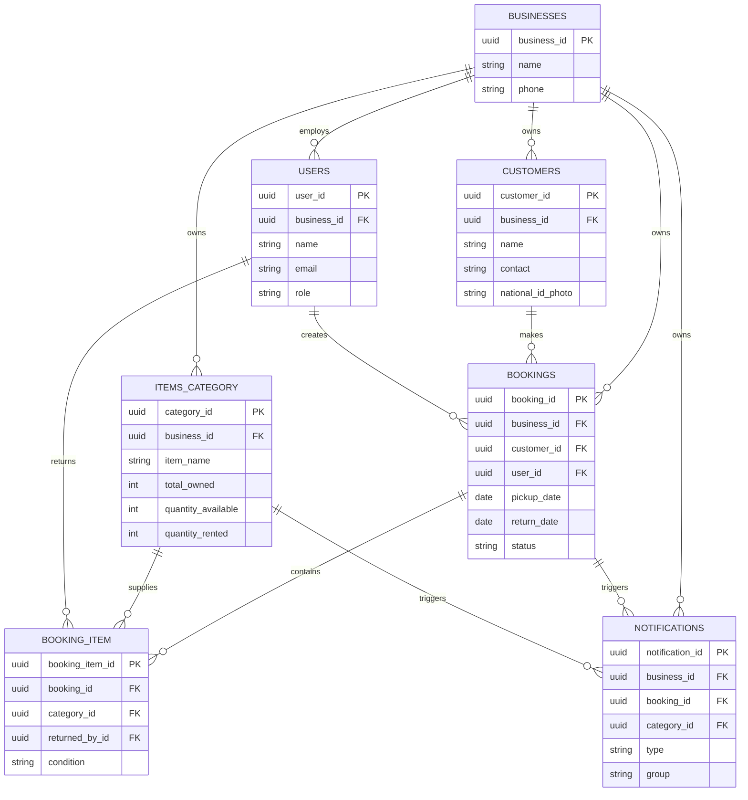
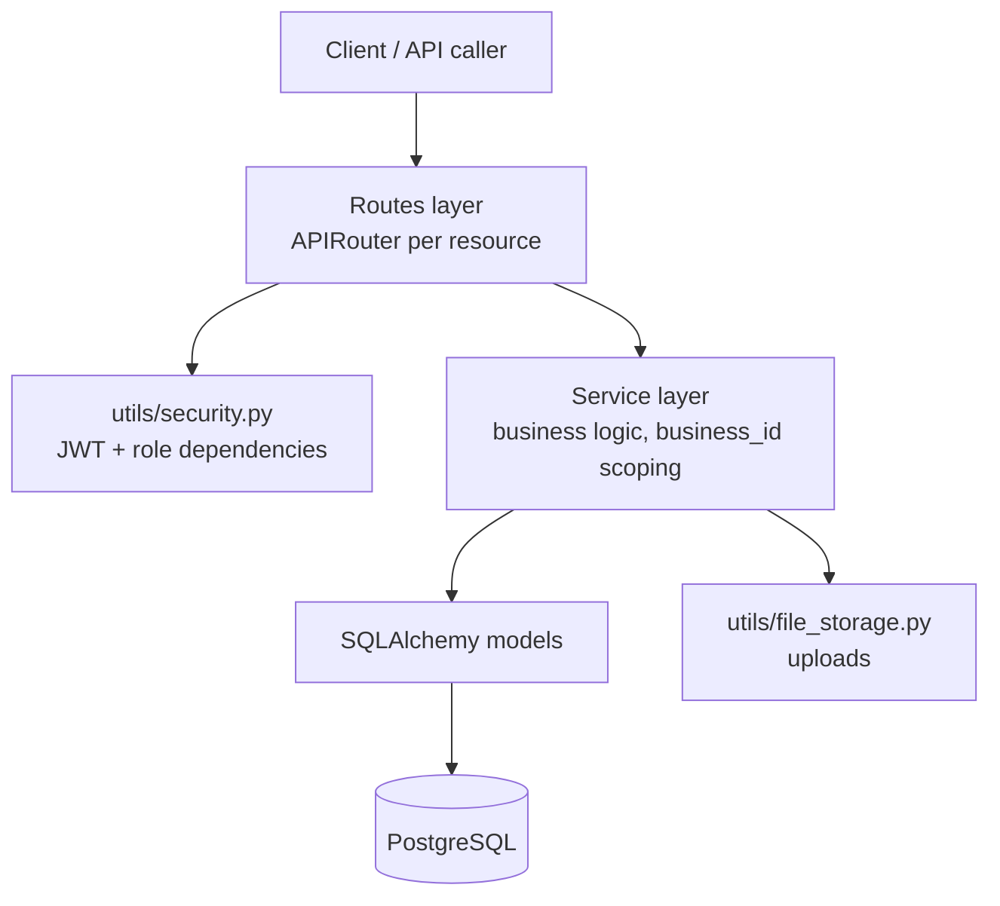
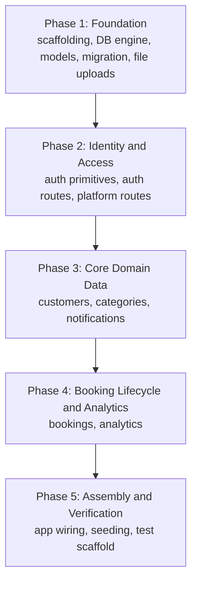

# DRMS Rebuild-from-Scratch Implementation Guide - Plan

## Goal Capsule

- **Objective:** Produce an implementation-ready guide that lets a developer build the DRMS FastAPI rental-management backend from an empty repository up to its current architecture — database through API — as one corrected end-state build rather than a replay of the actual migration history.
- **Authority hierarchy:** The current codebase is ground truth for every file this plan describes. This plan's corrected end-state schema (KTD1) wins over the literal historical migration sequence where the two differ.
- **Stop conditions:** If executing a unit would require changing product behavior, fixing a known permission gap (KTD4), or introducing a component absent from the current codebase, stop — this is a fidelity guide, not a redesign.
- **Execution profile:** `code` — "implementation" here means producing the actual DRMS backend from scratch, unit by unit, in dependency order.
- **Tail ownership:** `ce-work` or a human implementer executes the Implementation Units below in phase order. This plan does not cover deployment.

---

## Product Contract

### Summary

This plan sequences the DRMS FastAPI backend's build from an empty repository to its current architecture: project scaffolding, a database engine and seven domain tables delivered as one corrected end-state migration, JWT/role-based auth across three roles, and the customer/category/booking/notification/analytics API surface, ending with app assembly and a minimal test scaffold.

### Problem Frame

DRMS's backend was built incrementally: an initial integer-keyed schema was later converted to UUID primary keys, a column was renamed, a column was dropped, and a `businesses` multi-tenancy layer was bolted on after the fact — nine Alembic migrations in total. That history is a poor teaching path: an implementer following it verbatim would build the wrong primary-key type first and fix it four migrations later. This plan re-sequences the same end state into one linear build order, using the current codebase as the literal source for every file it describes.

### Requirements

**Foundation & data model**
- R1. The guide establishes project scaffolding (Python environment, pinned dependencies, `.env` configuration) before any application code, matching the actual stack: FastAPI, SQLAlchemy 2.x, Alembic, Pydantic 2.x, PostgreSQL via `psycopg2`, `PyJWT`, `bcrypt`, `python-multipart`.
- R2. The guide defines the database engine/session layer and a shared `Timestamp` mixin (`created_at`/`updated_at`/`deleted_at`/`is_deleted`) before any domain model, so every table inherits soft-delete and auditability from its first migration.
- R3. The guide defines seven domain tables — `businesses`, `users`, `customers`, `items_category`, `bookings`, `booking_item`, `notifications` — with UUID primary keys throughout and `business_id` scoping on every business-owned table, built as a single corrected end-state schema (KTD1) rather than the real project's multi-step migration history.

**Identity & access**
- R4. The guide builds JWT/bcrypt authentication and three role-gated FastAPI dependencies (`require_business_admin`, `require_business_member`, `require_super_admin`) reflecting the three roles: `super_admin` (platform), `business_admin` (shop owner), `staff`.
- R5. The guide covers public business self-registration (creating a `Business` and its `business_admin` owner atomically) and business-admin-scoped staff account management.
- R6. The guide covers platform-level business management (list/get/deactivate/reactivate) and a startup-seeded default super_admin.

**Core domain APIs**
- R7. The guide builds customer management (CRUD, national-ID-photo upload, reputation read-model) scoped to the caller's business.
- R8. The guide builds item-category (inventory) management (CRUD, image upload, the `total_owned`/`quantity_available`/`quantity_rented` stock invariant) scoped to the caller's business.
- R9. The guide builds the booking lifecycle: creation (inline new-customer, multi-line stock allocation), status auto-refresh (`ACTIVE`→`DUE`→`OVERDUE`), and return processing (per-item condition, stock release or write-off).

**Supporting systems**
- R10. The guide builds the notification system (creation triggers from booking/category events, list, mark-read) and the read-model analytics endpoints (per-business summary, platform-wide summary).
- R11. The guide builds shared file-upload handling for booking photos, category images, and national ID photos, served from a static mount.
- R12. The guide assembles the FastAPI app (router registration, OpenAPI tag grouping by role, startup seeding) as the final integration step.

**Fidelity to as-built behavior**
- R13. The guide documents current permission-enforcement gaps as-built — e.g. `require_business_member` gives Staff the same category/customer delete rights as Business Admin, despite `main.py`'s tag grouping implying a stricter split — rather than silently correcting them.

### Scope Boundaries

**In scope:** everything in Requirements above — a from-scratch build guide for the DRMS backend covering database, models, auth, service layer, routes, uploads, and app assembly.

**Out of scope:**
- Frontend/UI — none exists in this repository.
- Deployment, CI, and infrastructure.
- Payment processing.
- The permission-correctness and lifecycle redesign already scoped in `docs/plans/2026-08-11-001-docs-system-design-erd-permissions-plan.md` and `docs/plans/2026-08-12-001-feat-drms-erd-permissions-phased-plan.md` — those plans fix the gaps this plan only documents (R13).
- A literal replay of the actual historical migration sequence (see KTD1).

#### Deferred to Follow-Up Work
- Expanding automated test coverage beyond the smoke scaffold introduced in U14 — the per-unit test scenarios in this plan are the coverage target; a real suite is future work.

### Open Questions

None blocking. The scoping choices this plan makes (end-state vs. literal replay, scaffolding as unit one, including a test scaffold, documenting gaps rather than fixing them) were confirmed during planning — see Key Technical Decisions below.

---

## Planning Contract

### Key Technical Decisions

- KTD1. **Build to the corrected end-state schema, not a literal migration replay.** The real project's migration history includes self-corrections — an int→UUID primary-key fix, a `national_id_url`→`national_id_photo` rename, a dropped `businesses.email` column — that only exist because of earlier mistakes. Replaying them would teach an implementer to build the wrong thing first. *(session-settled: user-approved — chosen over literal migration replay: replaying corrections teaches mistakes as if they were intentional design)*
- KTD2. **Guide starts with project scaffolding (Unit 1), before database work.** "From scratch" means before any code exists, not just before the first table. *(session-settled: user-approved — chosen over starting at the database layer only: scaffolding is part of what "from scratch" covers)*
- KTD3. **Include a lightweight pytest scaffold (U14) as forward guidance**, even though the source repository's own `tests/` directory is empty. A rebuild guide that omits testing entirely under-serves its purpose even where the original build skipped it. *(session-settled: user-approved — chosen over omitting testing entirely: matches original build fidelity but under-serves a guide's purpose)*
- KTD4. **Document known permission-enforcement and concurrency gaps inline as as-built behavior, with a pointer to the separate correctness-redesign plans, rather than fixing them here.** Concrete examples: the permission gap named in R13, and the check-then-act stock-allocation race in U10 (no row locking between validating `quantity_available` and calling `adjust_rented`). This guide's job is fidelity to what was built. *(session-settled: user-approved — chosen over silently correcting the gaps: fixing them is a redesign, covered by the linked plans, not a rebuild guide)*
- KTD5. **One Alembic migration for the full end-state schema**, rather than one migration per table or a migration-per-historical-step. Keeps the from-scratch build linear and matches how a fresh project is actually bootstrapped.

### High-Level Technical Design

**Entity relationships.** Every business-owned table carries a `business_id` foreign key; `Booking` is the hub linking `Customer`, the creating `User`, and its `BookingItem` lines, each of which draws from an `ItemCategory`.

**Layered architecture.** Every resource follows the same routes → services → models flow, with security dependencies and file storage as cross-cutting concerns the route layer pulls in per endpoint.

**Build order.** The Implementation Units below are grouped into five phases, each depending on the last.

File uploads (U11) sits in Phase 1 rather than with the other "supporting systems" because U8 and U9 depend on it directly (photo/image upload on create); notifications (U12) sits in Phase 3 rather than Phase 4 because U10's booking triggers call into it, not the reverse.

---

## Implementation Units

### Unit Index

| U-ID | Title | Files touched | Depends on |
|---|---|---|---|
| U1 | Project Scaffolding & Configuration | `requirements.txt`, `.env`, `.gitignore`, `alembic.ini` | — |
| U2 | Database Engine, Session & Timestamp Mixin | `database/database.py`, `models/timestamp.py` | U1 |
| U3 | Core Domain Models | `models/*.py` | U2 |
| U4 | Initial Alembic Migration | `migrations/env.py`, `migrations/versions/` | U3 |
| U5 | Auth & Security Primitives | `utils/security.py`, `schemas/auth.py` | U3 |
| U6 | Auth & Business-Admin Routes | `service/auth.py`, `routes/auth.py` | U5 |
| U7 | Platform (Business) Management | `schemas/business.py`, `service/business.py`, `routes/business.py` | U5 |
| U8 | Customer Management | `schemas/customer.py`, `service/customer.py`, `routes/customer.py`, `service/reputation.py` | U5, U11 |
| U9 | Item Category (Inventory) Management | `schemas/category.py`, `service/category.py`, `routes/category.py` | U5, U11 |
| U10 | Booking Lifecycle | `schemas/booking.py`, `service/booking.py`, `routes/booking.py` | U8, U9, U12 |
| U11 | File Uploads | `utils/file_storage.py` | U1 |
| U12 | Notifications | `schemas/notification.py`, `service/notification.py`, `routes/notification.py` | U9 |
| U13 | Analytics & Platform Summary Wiring | `schemas/analytics.py`, `service/analytics.py`, `routes/analytics.py` | U10, U7 |
| U14 | App Assembly, Startup Seeding & Test Scaffolding | `main.py`, `tests/conftest.py`, `tests/test_health.py` | U6, U7, U8, U9, U10, U11, U12, U13 |

---

### U1. Project Scaffolding & Configuration

**Goal:** Stand up the Python project skeleton and pinned dependencies before any application code exists.

**Requirements:** R1

**Dependencies:** none

**Files:** `requirements.txt`, `.env`, `.gitignore`, `alembic.ini`

**Approach:**
1. Create a virtual environment and pin: `fastapi`, `uvicorn`, `sqlalchemy` (2.x), `alembic`, `psycopg2-binary`, `pydantic` (2.x) with the `email-validator` extra, `python-dotenv`, `PyJWT`, `bcrypt`, `python-multipart`.
2. Note: the source repository's `requirements.txt` omits `alembic` despite the project depending on it — pin it explicitly in the fresh build.
3. Define the required `.env` keys: `DATABASE_URL`, `SECRET_KEY`, `ALGORITHM`, `ACCESS_TOKEN_EXPIRE_MINUTES`, `SUPER_ADMIN_NAME`, `SUPER_ADMIN_EMAIL`, `SUPER_ADMIN_PHONE`, `SUPER_ADMIN_PASSWORD`, `UPLOAD_DIR`.
4. Run `alembic init migrations` to scaffold the migrations directory structure (wired to the app's models in U4).

**Patterns to follow:** none yet — this is the first unit.

**Test scenarios:** Test expectation: none -- scaffolding only, no application behavior to test.

**Verification:** dependency install succeeds; `alembic --version` runs; the app process can read every `.env` key via `python-dotenv`.

---

### U2. Database Engine, Session & Timestamp Mixin

**Goal:** Provide the SQLAlchemy engine/session/`Base` and the shared auditability mixin every domain model inherits.

**Requirements:** R2

**Dependencies:** U1

**Files:** `database/database.py`, `models/timestamp.py`

**Approach:**
1. `database/database.py`: read `DATABASE_URL` via `python-dotenv`, create the engine, a `sessionmaker`, a declarative `Base`, and a `get_db()` FastAPI dependency that yields a session and closes it in a `finally` block.
2. `models/timestamp.py`: a mixin (not a table) with `created_at`/`updated_at` server-defaulted to `now()` (`updated_at` also `onupdate=func.now()`), a nullable `deleted_at`, and a `is_deleted` boolean defaulting to `false` at both the Python and server-default level. Every domain model composes this mixin alongside `Base`.

**Patterns to follow:** none yet — exercised indirectly once a model exists (U3).

**Test scenarios:** Test expectation: none -- infrastructure only.

**Verification:** `get_db()` yields a working session against the configured database; a throwaway model built on `Timestamp` receives all four columns with the expected defaults.

---

### U3. Core Domain Models

**Goal:** Define the seven SQLAlchemy models that make up the canonical entity graph.

**Requirements:** R3

**Dependencies:** U2

**Files:** `models/business.py`, `models/user.py`, `models/customer.py`, `models/itemCategory.py`, `models/booking.py`, `models/booking_item.py`, `models/notification.py`, `models/__init__.py`

**Approach:**
1. Every model gets a UUID primary key (`default=uuid.uuid4`) and composes `Timestamp` + `Base`.
2. `Business`: `name`, `phone`. No `email` column — see KTD1; the real build added and then dropped one.
3. `User`: a `UserRole` enum (`super_admin`/`business_admin`/`staff`), a nullable `business_id` FK (null only for the platform super_admin), unique `email`.
4. `Customer`: `business_id` FK, `contact`, a `national_id_photo` column (mapped from a `nationalID_Photo` Python attribute), unique constraint on `(business_id, contact)`.
5. `ItemCategory`: `business_id` FK, stock fields `total_owned`/`quantity_available`/`quantity_rented`, `icon`/`tile_color` display fields, unique constraint on `(business_id, item_name)`.
6. `Booking`: `business_id`/`customer_id`/`user_id` FKs, a `BookingStatus` enum, and `photo_urls` as a Postgres `ARRAY(String)` column with server default `'{}'` — booking photos are not a separate table.
7. `BookingItem`: `booking_id`/`category_id`/`returned_by_id` FKs, an `ItemCondition` enum, per-item `condition`/`condition_notes`/`returned_at`.
8. `Notification`: `business_id` FK, optional `booking_id`/`category_id` FKs, `NotificationType`/`NotificationGroup` enums, a single `read` boolean (not per-user read state).
9. `models/__init__.py` re-exports every model and enum for one import surface.

**Patterns to follow:** `models/business.py`, `models/user.py`, `models/customer.py`, `models/itemCategory.py`, `models/booking.py`, `models/booking_item.py`, `models/notification.py` — these are the literal reference for column types and nullability.

**Test scenarios:**
- Happy path: instantiating each model with its required fields persists and round-trips through a session.
- Edge case: creating a second `Customer` with the same `(business_id, contact)` raises an integrity error; the same contact under a different business succeeds.
- Edge case: creating a second `ItemCategory` with the same `(business_id, item_name)` raises an integrity error.
- Edge case: a `Booking` created without photos defaults `photo_urls` to `[]`, not `NULL`.

**Verification:** a session can create one row per table and traverse every relationship (`business.users`, `customer.bookings`, `booking.items`, `booking_item.category`) without error.

---

### U4. Initial Alembic Migration (End-State Schema)

**Goal:** Generate and hand-verify one migration that creates all seven tables in their corrected end-state shape.

**Requirements:** R3

**Dependencies:** U3

**Files:** `migrations/env.py`, `migrations/versions/`

**Approach:**
1. Wire `migrations/env.py`'s `target_metadata` to `Base.metadata` and set `sqlalchemy.url` from the app's `DATABASE_URL` — not the static value in `alembic.ini` — so the app and migrations share one source of truth.
2. Run `alembic revision --autogenerate`, then hand-verify the result: every primary key is UUID (autogenerate sometimes needs a manual nudge for Postgres UUID columns), every business-owned table has an indexed `business_id` foreign key, both unique constraints from U3 are present, and `downgrade()` also drops all five Postgres ENUM types Alembic's autogenerate doesn't clean up on its own (`userrole`, `bookingstatus`, `itemcondition`, `notificationtype`, `notificationgroup`).

**Patterns to follow:** `migrations/env.py`, `migrations/versions/a11f6540ec60_create_initial_schema.py` (the ENUM-cleanup-on-downgrade pattern).

**Test scenarios:** Test expectation: none -- schema migration, verified operationally below.

**Verification:** `alembic upgrade head` succeeds against a fresh database; `alembic downgrade base` followed by `alembic upgrade head` again succeeds without an "ENUM already exists" error.

---

### U5. Auth & Security Primitives

**Goal:** Build JWT/bcrypt authentication and the three role-gate FastAPI dependencies every other route depends on.

**Requirements:** R4

**Dependencies:** U3

**Files:** `utils/security.py`, `schemas/auth.py`

**Approach:**
1. Password hashing via bcrypt `hashpw`/`checkpw`.
2. Tokens: `create_access_token(user_id)` encodes `{sub, exp}` with `PyJWT`; `decode_access_token` raises 401 on any `PyJWTError` or a missing `sub`.
3. `get_current_user`: resolves the bearer token to a `User`, rejects a deleted user, and — when the user belongs to a business — rejects the request if that business is deactivated.
4. Three role dependencies built on `get_current_user`: `require_business_admin` (business_admin or super_admin; 403 if a business_admin has no `business_id`), `require_business_member` (any role with a non-null `business_id` — blocks super_admin), `require_super_admin` (super_admin only).
5. `schemas/auth.py`: `LoginRequest`, `Token`, `UserCreate`/`UserUpdate`/`UserRead`, `BusinessRegisterRequest`/`BusinessRegisterResponse`.

**Patterns to follow:** `utils/security.py`, `schemas/auth.py`.

**Test scenarios:**
- Happy path: a token round-trips through `create_access_token`/`decode_access_token` to the original `user_id`.
- Happy path: `get_current_user` resolves an active user with a valid token.
- Edge case: an expired or tampered token raises 401.
- Edge case: a token for a deleted user raises 401.
- Edge case: a token for a user whose business is deactivated raises 401.
- Error path: `require_business_admin` rejects a staff token with 403; `require_business_member` rejects a super_admin token with 403; `require_super_admin` rejects a business_admin token with 403.
- Edge case: a business_admin with `business_id=None` (bad data) is rejected by `require_business_admin` with 403.

**Verification:** every role × dependency combination in the matrix above is covered by a passing test.

---

### U6. Auth & Business-Admin Routes: Registration, Login, Staff Management

**Goal:** Expose public registration/login and business-admin-scoped staff account management.

**Requirements:** R5, R6 (seed half)

**Dependencies:** U5

**Files:** `service/auth.py`, `routes/auth.py`

**Approach:**
1. `register_business`: creates a `Business` and its owner `User` (role `business_admin`) atomically — `db.flush()` the business to get its id before creating the owner, one `db.commit()` for both.
2. `authenticate_user`: looks up by email among non-deleted users, verifies password.
3. `create_staff_user`/`list_staff_users`/`get_staff_user_in_business`/`update_staff_user`/`deactivate_staff_user`/`delete_staff_user`: every staff-account operation takes `business_id` from the authenticated admin's token, never from the request body, and scopes its query to that business.
4. `seed_default_super_admin`: idempotent — a no-op if any super_admin exists or the configured seed email is already taken.
5. Routes: `POST /auth/register-business` (public), `POST /auth/login` (public), `GET /auth/me`, then `/auth/users` CRUD gated by `require_business_admin`.

**Patterns to follow:** `service/auth.py`, `routes/auth.py`.

**Test scenarios:**
- Happy path: `register-business` creates one business and one business_admin user in a single transaction.
- Happy path: `login` with correct credentials returns a bearer token; `me` with that token returns the caller.
- Happy path: a business_admin creates, lists, updates, deactivates, and deletes a staff user scoped to their own business.
- Edge case: `register-business` with an email already in use returns 400, not a raw integrity error.
- Edge case: `login` with a wrong password or unknown email returns 401 without revealing which.
- Error path: a business_admin cannot read/update/delete a staff user belonging to a different business — 404, not 403, so existence isn't leaked cross-business.
- Integration: `seed_default_super_admin` run a second time does not create a duplicate super_admin.

**Verification:** an end-to-end register → login → create-staff → deactivate-staff flow succeeds for one business and cannot see or touch a second business's staff.

---

### U7. Platform (Business) Management

**Goal:** Expose super_admin-only endpoints to manage businesses and view platform-wide numbers.

**Requirements:** R6 (business-management half)

**Dependencies:** U5

**Files:** `schemas/business.py`, `service/business.py`, `routes/business.py`

**Approach:**
1. `list_businesses`/`get_business`: join each business to its `business_admin` owner and a non-deleted staff count for the read-model shape.
2. `deactivate_business`/`reactivate_business`: flip `is_deleted`/`deleted_at`; the effect is enforced at auth time by U5's `get_current_user`, not here.
3. `get_platform_summary`: aggregate counts (businesses, staff, bookings, revenue, active rentals) plus a top-10-by-bookings ranking, excluding soft-deleted rows throughout.
4. Routes under `/businesses`, all gated by `require_super_admin`.

**Patterns to follow:** `service/business.py`, `routes/business.py`.

**Test scenarios:**
- Happy path: `list_businesses`/`get_business` include the correct `owner_name`/`owner_email`/`staff_count` for a business with staff.
- Happy path: deactivating a business, then attempting to log in as one of its staff, fails at auth (the cross-unit contract with U5).
- Edge case: `get_business` for an unknown id returns 404.
- Integration: `get_platform_summary`'s top-10 ranking and revenue sum exclude soft-deleted bookings and businesses.

**Verification:** a business_admin or staff token gets 403 on every `/businesses` route; a super_admin token succeeds on all of them.

---

### U8. Customer Management

**Goal:** Expose business-scoped customer CRUD, national-ID-photo upload, and the reputation read-model.

**Requirements:** R7, R13

**Dependencies:** U5, U11

**Files:** `schemas/customer.py`, `service/customer.py`, `routes/customer.py`, `service/reputation.py`

**Approach:**
1. `create_customer`/`update_customer`/`get_customer`/`list_customers` (paginated, name/contact search) all take `business_id` from the caller and scope every query to it; the unique-contact-per-business constraint from U3 surfaces as a caught `IntegrityError` mapped to a 400.
2. `upload_national_id_photo`: delegates to `utils.file_storage.save_customer_national_id_photo`.
3. `get_reputation`: derived, never persisted — classifies a customer as new (no closed bookings), flagged (any `DAMAGED` closed booking), or good-history, from their closed bookings alone.
4. Routes accept multipart form data so create-with-photo is one request.
5. Per R13: `delete_customer` is gated by `require_business_member`, not `require_business_admin` — Staff can delete a customer, the same as Business Admin. Document this as-built (see KTD4); do not add a stricter dependency.

**Patterns to follow:** `schemas/customer.py`, `service/customer.py`, `routes/customer.py`, `service/reputation.py`.

**Test scenarios:**
- Happy path: creating a customer with a national-ID photo in one multipart request persists both the row and the photo.
- Happy path: a customer's reputation reads "new" with no bookings, "good history" after all-`GOOD` returns, and "flagged" after a `DAMAGED` return.
- Edge case: creating a second customer with a contact already used in the same business returns 400; the same contact in a different business succeeds.
- Edge case: search matches by name substring and by a digits-only contact substring.
- Error path: reading/updating/deleting a customer belonging to a different business returns 404.

**Verification:** pagination (`page`/`page_size`/`total_pages`) is correct at a boundary — exactly `page_size` rows, and one more than `page_size`.

---

### U9. Item Category (Inventory) Management

**Goal:** Expose business-scoped category CRUD with image upload and the stock-quantity invariant.

**Requirements:** R8, R13

**Dependencies:** U5, U11

**Files:** `schemas/category.py`, `service/category.py`, `routes/category.py`

**Approach:**
1. `create_category`: `quantity_available` initializes to `total_owned`, `quantity_rented` to 0.
2. `update_category`: every field except `total_owned` is a direct partial update; changing `total_owned` recomputes `quantity_available = total_owned - quantity_rented` rather than accepting a client-supplied value — `quantity_available`/`quantity_rented` are never independently client-writable.
3. `adjust_rented(category, delta)`: the sole path that moves stock between available and rented (positive on checkout, negative on a good return).
4. `write_off(category, quantity)`: the sole path that permanently removes stock — reduces `total_owned` and `quantity_rented` together, for damaged/missing returns.
5. Routes accept multipart form data for create-with-image; the unique-item-name-per-business constraint surfaces the same way as U8's customer-contact constraint.
6. Per R13: `delete_category` is gated by `require_business_member`, not `require_business_admin` — Staff can delete a category, the same as Business Admin. Document this as-built (see KTD4); do not add a stricter dependency.

**Patterns to follow:** `schemas/category.py`, `service/category.py`, `routes/category.py`.

**Test scenarios:**
- Happy path: creating a category sets `quantity_available = total_owned`, `quantity_rented = 0`.
- Happy path: `adjust_rented` and `write_off` preserve `total_owned = quantity_available + quantity_rented` after each call.
- Edge case: `update_category` changing `total_owned` while stock is rented recomputes `quantity_available` correctly rather than overwriting it.
- Edge case: creating a second category with a name already used in the same business returns 400.
- Error path: reading/updating/deleting a category belonging to a different business returns 404.

**Verification:** the stock invariant (`total_owned = quantity_available + quantity_rented`) holds after every create/update/adjust/write-off path exercised in tests.

---

### U10. Booking Lifecycle

**Goal:** Expose booking creation with stock allocation, status auto-refresh, and return processing.

**Requirements:** R9

**Dependencies:** U8, U9, U12

**Files:** `schemas/booking.py`, `service/booking.py`, `routes/booking.py`

**Approach:**
1. `create_booking`: accepts either an existing `customer_id` or an inline `new_customer` (deduplicated by contact within the business first); groups line items by category, validates each category has enough `quantity_available`, calls `category_service.adjust_rented` per category, then raises a low-stock notification when the post-checkout available count crosses the threshold.
2. `refresh_all_statuses`: recomputes `ACTIVE`/`DUE`/`OVERDUE` from `return_date` for every open booking in the business on every list/get call, raising a due-soon or overdue notification on each transition into those states.
3. `process_return`: records `condition`/`condition_notes`/`returned_at`/`returned_by_id` per `BookingItem`; an all-`GOOD` return releases stock via `adjust_rented(-qty)` and sets `RETURNED`; any non-`GOOD` item write-offs that category's stock via `write_off` and sets the whole booking `DAMAGED`, plus a notification.
4. `to_booking_dict`/`to_booking_list_dict`: derive the grouped per-category `items` summary from the flat `BookingItem` rows for the read schemas.
5. Per KTD4: the checkout sequence in step 1 (validate `quantity_available`, then call `adjust_rented`) is an undocumented concurrency gap in the current codebase — no row locking or serializable transaction guards it, so two concurrent bookings against the same near-empty category can both pass validation and jointly oversell stock. Document this inline as as-built behavior, with the same correctness-redesign-plan pointer R13 uses; do not add locking here.
6. The source repository's booking-photo upload route (a `POST /bookings/{booking_id}/photos` handler) exists only as commented-out dead code. Leave it unwired in this unit to match as-built fidelity — R11's booking-photos clause is satisfied by U11's `save_booking_photo` utility and U3's `photo_urls` column alone, not a live endpoint.

**Patterns to follow:** `schemas/booking.py`, `service/booking.py`, `routes/booking.py`.

**Test scenarios:**
- Happy path: creating a booking with an existing customer and line items from two different categories allocates stock from both.
- Happy path: creating a booking with `new_customer` whose contact matches an existing customer in the business reuses that customer instead of creating a duplicate.
- Happy path: an all-`GOOD` return sets status `RETURNED` and releases every line's category stock.
- Happy path: a `DAMAGED` or `MISSING` return sets status `DAMAGED`, write-offs that category's stock, and raises a notification.
- Edge case: requesting more units of a category than `quantity_available` raises `BookingError`, mapped to 400, with no partial stock allocation.
- Edge case: `return_date` before `pickup_date` is rejected by the schema validator before it reaches the service.
- Edge case: a booking already `RETURNED`/`DAMAGED` cannot be returned again.
- Integration: listing bookings triggers `refresh_all_statuses` first, so a booking whose `return_date` has passed shows `OVERDUE` on read even without an intervening write.
- Integration: a checkout that drops a category's `quantity_available` to the low-stock threshold raises U12's low-stock notification.

**Verification:** the U9 stock invariant holds through a full create → return cycle, for both the `GOOD` and non-`GOOD` return paths.

---

### U11. File Uploads

**Goal:** Provide the shared upload-handling utility used by categories, customers, and bookings.

**Requirements:** R11 (upload-handling half)

**Dependencies:** U1

**Files:** `utils/file_storage.py`

**Approach:**
1. One `save_*` function per upload kind (`save_booking_photo`, `save_customer_national_id_photo`, `save_category_image`), each validating content-type against an allowed-image-types map (`jpeg`/`png`/`webp`), writing under `UPLOAD_DIR/<kind>/<entity_id>/...`, and returning the `/uploads/...` URL stored on the owning row.
2. `UPLOAD_DIR` is created (`mkdir(parents=True, exist_ok=True)`) at app startup, before the static mount (U14) attaches it.

**Patterns to follow:** `utils/file_storage.py`.

**Test scenarios:**
- Happy path: uploading a `.jpg`/`.png`/`.webp` file for each of the three kinds saves it under the expected path and returns a matching URL.
- Edge case: an unsupported content type (e.g. `application/pdf`) raises 400 with a clear message, for all three upload kinds.
- Edge case: uploading a second national-ID photo for the same customer overwrites the first (fixed filename), while booking photos accumulate under distinct UUID-named files instead.

**Verification:** a round-trip request through an actual upload endpoint (not just the utility function) resolves the returned URL to a file that exists on disk.

---

### U12. Notifications

**Goal:** Expose the notification system: creation triggers wired from booking/category events, listing, and mark-read.

**Requirements:** R10 (notifications half)

**Dependencies:** U9

**Files:** `schemas/notification.py`, `service/notification.py`, `routes/notification.py`

**Approach:**
1. `create_notification`: the single write path every trigger calls into — U9's `notify_low_stock` first, then U10's due-soon/overdue and damaged-return triggers once that unit lands; it `db.flush()`s rather than commits, so it composes inside the caller's transaction. Built before U10 (not after) precisely because U10's booking triggers depend on this write path existing.
2. `list_notifications`/`mark_read`: scoped to the caller's business; `read` is a single boolean on the row, not per-user read state.
3. `NotificationRead`'s computed `time` field renders a human-relative timestamp (`utils/time_utils.time_ago`) from `created_at`.

**Patterns to follow:** `schemas/notification.py`, `service/notification.py`, `routes/notification.py`, `utils/time_utils.py`.

**Test scenarios:**
- Happy path: listing notifications for a business returns only that business's rows, newest first.
- Happy path: marking a notification read flips `read` to true and is idempotent on a second call.
- Edge case: marking a notification belonging to a different business as read returns 404.
- Integration: once U9 and U10 exist, a low-stock checkout, a due-soon/overdue transition, and a damaged return each produce exactly one notification of the expected `type`/`group`.

**Verification:** every notification-producing trigger in U9/U10 is exercised at least once (once those units exist) and asserted against the resulting row's `type`/`group`/`booking_id`/`category_id`.

---

### U13. Analytics & Platform Summary Wiring

**Goal:** Expose the per-business analytics summary alongside the platform summary built in U7.

**Requirements:** R10 (analytics half)

**Dependencies:** U10, U7

**Files:** `schemas/analytics.py`, `service/analytics.py`, `routes/analytics.py`

**Approach:**
1. `get_summary`: this-month revenue and active-rental count, top-5 categories by booking-item count, a 30-day (falling back to all-time when empty) average rental duration, and a weekly-bucketed booking count for the current month — all computed on read from `Booking`/`BookingItem`, never persisted.
2. `GET /analytics/summary` is gated by `require_business_admin`, additionally rejecting a business-less caller (a super_admin token) with 403, since analytics is per-shop.
3. `GET /analytics/platform` (from U7's `get_platform_summary`) is gated by `require_super_admin`.

**Patterns to follow:** `schemas/analytics.py`, `service/analytics.py`, `routes/analytics.py`.

**Test scenarios:**
- Happy path: revenue and active-rental counts reflect only the caller's business.
- Happy path: top-categories ranking and average-rental-duration fall back to all-time when no booking closed in the last 30 days.
- Edge case: a super_admin token against `/analytics/summary` returns 403.
- Error path: a business_admin or staff token against `/analytics/platform` returns 403.

**Verification:** `get_summary`'s revenue and active-rental numbers match a hand-computed total for a small fixture set of bookings.

---

### U14. App Assembly, Startup Seeding & Test Scaffolding

**Goal:** Wire every router into one FastAPI app, seed the default super_admin on startup, and give the implementer a minimal pytest scaffold to build real coverage on.

**Requirements:** R12, R11 (mount half)

**Dependencies:** U6, U7, U8, U9, U10, U11, U12, U13

**Files:** `main.py`, `tests/conftest.py`, `tests/test_health.py`

**Approach:**
1. `main.py`: instantiate `FastAPI` with `openapi_tags` grouped by role (`Auth`, `Business Admin`, `Staff`, `Platform`) matching the tags each router already declares; `include_router` every router; mount `UPLOAD_DIR` at `/uploads` before the routers so uploaded files resolve.
2. A `startup` event calls `seed_default_super_admin` once per process boot.
3. `tests/conftest.py`: a pytest fixture pointing `DATABASE_URL` at a disposable test database and yielding a `TestClient`.
4. `tests/test_health.py`: one smoke test per role (register-business, login, one gated route per role) proving the wiring is correct end-to-end — not a substitute for the per-unit test scenarios above.

**Execution note:** the source repository's own `tests/` directory is empty — treat this unit as forward guidance for the fresh build rather than a replay of what was actually shipped; prefer install/runtime smoke verification for `main.py` itself, and test-first coverage for the fixture and smoke tests.

**Patterns to follow:** `main.py`.

**Test scenarios:**
- Happy path: the app starts, `/docs` renders, and every router's routes appear in the OpenAPI schema under the correct tag.
- Happy path: `seed_default_super_admin` run at startup against an empty database creates exactly one super_admin; a second startup does not create a duplicate.
- Integration: a full register-business → login → create-category → create-booking → return-booking flow succeeds through the assembled app via `TestClient`, exercising every layer from routes down to the database.

**Verification:** the app boots against a fresh database without error; the integration flow above passes.

---

## Verification Contract

| Gate | Command / check | Applies to |
|---|---|---|
| Migration applies cleanly | `alembic upgrade head` against a fresh Postgres database | U4 |
| Migration is reversible | `alembic downgrade base && alembic upgrade head` | U4 |
| App boots | `uvicorn main:app --reload` starts without error | U14 |
| OpenAPI wiring | `/docs` lists every router's routes under the correct role tag | U14 |
| Stock invariant | `total_owned = quantity_available + quantity_rented` holds after every category/booking test | U9, U10 |
| Cross-business isolation | every scoped read/update/delete route returns 404 (not the other business's data) for a caller in a different business | U6, U7, U8, U9, U10, U12 |
| Automated suite | `pytest` — once U14's scaffold exists, every per-unit test scenario above is expressed as a test | U1–U14 |

---

## Definition of Done

- All 14 Implementation Units are built and match the file list in the Unit Index.
- `alembic upgrade head` creates the full schema from empty in one pass, and the downgrade/upgrade cycle in the Verification Contract succeeds.
- The assembled app boots and the end-to-end integration flow in U14 passes.
- The stock invariant and cross-business isolation gates in the Verification Contract pass for every resource that carries them.
- The permission gaps named in R13/KTD4 are documented in the guide, not silently fixed.
- No dead-end or exploratory code from abandoned approaches remains in the final diff.

---

## Risks & Dependencies

- **Postgres-specific schema.** `ARRAY(String)` on `Booking.photo_urls` and native `ENUM` types on `UserRole`/`BookingStatus`/`ItemCondition` tie the schema to PostgreSQL — there is no straightforward SQLite fallback for U14's test scaffold; plan on a real (or containerized) Postgres instance for tests, not an in-memory substitute.
- **Seeded credentials.** `seed_default_super_admin` uses `.env`-configured (or hardcoded-fallback) credentials — rotate `SUPER_ADMIN_PASSWORD` before any real deployment; this guide only covers local/dev bootstrap.
- **Dependency gap in the source repo.** The current `requirements.txt` does not list `alembic` even though the project depends on it (U1 corrects this in the fresh build).

---

## Sources & Research

- `models/*.py`, `schemas/*.py`, `service/*.py`, `routes/*.py`, `main.py` — the literal reference for every unit's Approach above.
- `migrations/versions/` (9 revisions, chained from `a11f6540ec60` through `1e2de1f455b9`) — source for the historical build order KTD1 deliberately does not replay.
- `migrations/env.py`, `alembic.ini` — source for U4's Alembic wiring.
- `utils/security.py`, `utils/file_storage.py`, `utils/time_utils.py` — source for U5, U11, U12.
- `docs/plans/2026-08-11-001-docs-system-design-erd-permissions-plan.md`, `docs/plans/2026-08-12-001-feat-drms-erd-permissions-phased-plan.md` — the separate correctness-redesign plans this guide points to for R13's documented gaps, rather than duplicating their fixes here.
